<p align="right"><a href="https://github.com/mozership/probe/blob/main/README.md">English</a> | 日本語</p>

<br><br><br><br>

<p align="center">
  
</p>

<br><br><br><br>

<p align="center">
  <strong>Probe</strong>は、AIが書いたコードに、動く証拠を付けるツールです。APIを呼び、書き込まれた行を問い合わせ、送信されたメールを読むまでを1つのYAMLワークフローで行い、そのレポートが証拠になります。
</p>

<p align="center">
  <a href="https://github.com/mozership/probe/actions/workflows/test.yml">
    
  </a>
  <a href="https://github.com/mozership/probe/releases">
    
  </a>
  <a href="http://godoc.org/github.com/mozership/probe">
    
  </a>
</p>

AIエージェントがサービスを変更したとき、その変更が動くことは、AIエージェント自身が書いたコードやユニットテストとは別のもので示す必要があります。Probeのワークフローは、それを外側から示します。読みやすいYAMLで、動いているサービスをHTTP、gRPC、データベース、メール、SSH、シェル越しに操作し、ジョブを並行して実行しながら、応答を1つずつ検証します。AIエージェントは`probe skill`でワークフローの書き方を学び、`probe check`は実行する前に書き間違いを見つけ、`--read-only`と`--allow-host`は許可していない書き込みと接続を拒否します。Probeは単体のバイナリで、手元でも、CIでも、cronからでも同じように動き、結果は終了コードに反映されます。ドキュメント: [probe.linyo.ws/ja](https://probe.linyo.ws/ja)

<p align="center">
  
</p>

特徴
----

Probeは、情報工学の実験を再現できるようにするために作られました。さまざまなプロトコルを使う複雑なワークフローを、読みやすいYAMLで簡潔に書き、同じ手順で何度でも実行できます。同じワークフローは、ソフトウェアの信頼性を確かめるEnd-to-endテストにも使えます。コードを書くのが人ではなくAIエージェントになりつつある今、その重要性は増しています。

- **AIコーディングへの対応**: `probe skill`は、インストールしたバージョンに合うワークフローの書き方をAIエージェントに教えます。`probe check`は、実行する前に書き間違いを見つけます。`--read-only`と`--allow-host`は、書き込みと、指定していないホストへの接続を、送る前に拒否します。そのため、AIエージェントが書いたワークフローを安全に実行できます。ステップは、AIエージェントが書いた`test`だけでなく、OpenAPIドキュメントや`.proto`ファイルの仕様とも照合できます。
- **柔軟性**: HTTP、gRPC、MySQL、PostgreSQL、SQLite、SMTP、IMAP、DNS、SSH、シェルが組み込みで、ブラウザ、GraphQL、JMAPは外部アクションで扱えます。新しいプロトコルも、独立したアクションとして追加できます。ジョブは`needs`で順序を決めない限り並行して動くため、エンドポイントを呼び、書き込まれた行を問い合わせ、送信されたメールを読む処理を1回の実行で行えます。`repeat`を加えれば、同じワークフローを一定の間隔で動かす監視にもなります。
- **運用性**: ワークフローは読みやすいYAMLで定義します。ログインのように複数のシナリオで共通する手順は1つのジョブファイルにまとめ、`uses: embedded`で呼び出せます。Probeは単体のバイナリで、併せて入れるものはありません。手元でも、CIでも、cronからでも同じように動きます。ジョブの構造は`probe dag`でASCIIまたはMermaidのフローチャートとして出力できます。結果は端末にジョブごとに表示され、失敗したステップには理由が添えられます。`--report`を使えば、JSON、JUnit XML、Markdown、GitHub Actionsのジョブサマリーとしても書き出せます。

このほかワークフローには、ステップやジョブの間でデータを渡す`outputs`、任意の応答を検証し、成立しなかった条件を示す`test`、`retry`、`skipif`、`wait`、`timeout`、ワークフローに書いたリストやファイルから読んだリストを繰り返す`iteration`、ステップやジョブの間で共通する設定をまとめる`defaults`、最初の失敗でジョブを止める`fail_fast`、失敗の後にも実行する後片付けのための`always`、そしてコマンドラインで複数のYAMLをマージする機能があり、実行のたびに変わる値は`--var`と`--env-file`で与えられます。

これらの関係は[Probeの理解](https://probe.linyo.ws/ja/guide/introduction/understanding-probe)で、k6、Hurl、Venom、runn、Blackbox exporter、GitHub Actionsのいずれを選んだほうがよいかは[比較](https://probe.linyo.ws/ja/guide/introduction/comparison)で説明しています。


クイックスタート
----------------

Homebrewでバイナリをインストールします。

```bash
brew install mozership/tap/probe
```

Goがあれば`go install github.com/mozership/probe/cmd/probe@latest`でも入ります。GitHub Actionsでは[`mozership/probe-action`](https://github.com/mozership/probe-action)がインストールと実行を行います。どちらもない環境でリリースをダウンロードしてチェックサムを検証するコマンドなど、ほかの方法は[インストール](https://probe.linyo.ws/ja/guide/introduction/installation)にあります。

ワークフローを書きます。

```yaml
# health-check.yml
name: API Health Check
jobs:
- name: Check API Status
  steps:
  - name: Ping API
    uses: http
    with:
      url: https://api.example.com
      get: /health
    test: res.code == 200
```

実行します。

```bash
probe health-check.yml
```

```
API Health Check

⏺ Check API Status (Completed in 0.02s)
  ⎿ 0. ✓  Ping API

Total workflow time: 0.02s ✓ All jobs succeeded
```

[クイックスタート](https://probe.linyo.ws/ja/guide/introduction/quickstart)では同じ手順を順に追い、[最初のワークフロー](https://probe.linyo.ws/ja/guide/introduction/your-first-workflow)では動かし続けられる形まで広げます。

AIエージェントと使う
------------------------------

プロジェクトにスキルを入れます。AIエージェントは、インストールされているバージョンに合うワークフローの書き方、検査の仕方、失敗の読み方をスキルから学びます。

```bash
probe skill install                        # .claude/skills/probe/SKILL.md（Claude Code向け）
probe skill install .agents/skills/probe   # AIエージェントがスキルを読む、ほかのディレクトリ
```

次に、いつ使うのかを`AGENTS.md`や`CLAUDE.md`など、AIエージェントが指示を読むファイルに書きます。

```markdown
## End-to-endの確認

- サービスがネットワーク越しに行うこと（エンドポイント、クエリ、送信するメール）を変更したら、動いているサービスに対してその変更を確かめるProbeのワークフローを`probe/`に追加するか、既存のものを更新する。
- YAMLを書く前に`probe guide`を読む。パラメータを推測で書かない。
- `probe check <file>`を実行してエラーをすべて直してから、`probe --report markdown=probe-report.md <file>`を実行する。
- ワークフローが通ったら変更は完了とする。`probe-report.md`をプルリクエストに載せる。
- `probe`が入っていなければ、`brew install mozership/tap/probe`か`go install github.com/mozership/probe/cmd/probe@latest`で入れる。
```

AIエージェントが書いたワークフローを`--read-only`で実行する方法、応答をOpenAPIドキュメントと照合する方法、同じ実行をCIで行う方法は、[AIエージェントと使う](https://probe.linyo.ws/ja/guide/how-tos/coding-agents)で説明しています。

組み込みアクション
------------------

| アクション | 用途 |
|---|---|
| [`http`](https://probe.linyo.ws/ja/reference/actions/http) | HTTPリクエストとその応答 |
| [`db`](https://probe.linyo.ws/ja/reference/actions/db) | MySQL、PostgreSQL、SQLiteへのクエリ |
| [`smtp`](https://probe.linyo.ws/ja/reference/actions/smtp) | メールの送信 |
| [`imap`](https://probe.linyo.ws/ja/reference/actions/imap) | メールボックスの読み取り |
| [`ssh`](https://probe.linyo.ws/ja/reference/actions/ssh) | リモートホストでのコマンド実行 |
| [`shell`](https://probe.linyo.ws/ja/reference/actions/shell) | Probeを実行しているマシンでのコマンド実行 |
| [`grpc`](https://probe.linyo.ws/ja/reference/actions/grpc) | gRPCとConnectの呼び出し（ストリーミングを含む） |
| [`dns`](https://probe.linyo.ws/ja/reference/actions/dns) | 名前に対してDNSサーバーが返すレコード |
| [`embedded`](https://probe.linyo.ws/ja/reference/actions/embedded) | ステップから別のジョブファイルを実行 |
| [`hello`](https://probe.linyo.ws/ja/reference/actions/hello) | レポートへの出力 |

次の外部アクションは、それぞれ独立したリポジトリにあり、ステップからコミットで固定して使います。

| アクション | 用途 |
|---|---|
| [agent](https://probe.linyo.ws/ja/reference/actions/agent) | 言葉で書いたタスクからの、モデルによるWebアプリケーションのテスト |
| [browser](https://probe.linyo.ws/ja/reference/actions/browser) | 実際のブラウザの操作 |
| [container](https://probe.linyo.ws/ja/reference/actions/container) | 実行のためのコンテナの起動と、終了後の削除 |
| [graphql](https://probe.linyo.ws/ja/reference/actions/graphql) | HTTPでのGraphQLのクエリ |
| [jmap](https://probe.linyo.ws/ja/reference/actions/jmap) | JMAPのメソッドの呼び出し |
| [mail-latency](https://probe.linyo.ws/ja/reference/actions/mail-latency) | 受信したメールからの配送遅延の計測 |
| [redis](https://probe.linyo.ws/ja/reference/actions/redis) | RedisまたはValkeyのサーバーでのコマンドの実行 |
| [s3](https://probe.linyo.ws/ja/reference/actions/s3) | S3とS3互換ストレージのオブジェクトの読み書き |
| [websocket](https://probe.linyo.ws/ja/reference/actions/websocket) | WebSocketでのメッセージの送受信 |

ドキュメント
------------

- [ガイド](https://probe.linyo.ws/ja/guide): インストール、CLI、そしてワークフロー、ジョブ、ステップ、データフローの考え方
- [How-to](https://probe.linyo.ws/ja/guide/how-tos/coding-agents): AIエージェントとの併用、APIテスト、監視、パフォーマンス、環境管理、エラーハンドリング
- [チュートリアル](https://probe.linyo.ws/ja/guide/tutorials/first-monitoring-system): 監視システム、APIテストパイプライン、マルチ環境テストの構築
- [リファレンス](https://probe.linyo.ws/ja/reference): YAMLの設定、CLIのオプション、組み込み関数、環境変数

実行できるワークフローは[`examples/`](./examples/)にあります。

コントリビューション
--------------------

Issue、機能の要望、プルリクエストのいずれも歓迎します。

ライセンス
----------

MITです。[LICENSE](./LICENSE)を参照してください。

実行ファイルには、それぞれ独自のライセンスを持つ他のソフトウェアが組み込まれています。リリースのアーカイブには、それらのライセンス文をまとめた`THIRD_PARTY_LICENSES`が入っています。ソースからは`make licenses`で同じファイルを生成できます。

作者
----

[linyows](https://github.com/linyows)
