<p align="right">English | <a href="https://github.com/mozership/probe/blob/main/README.ja.md">日本語</a></p>

<br><br><br><br>

<p align="center">
  
</p>

<br><br><br><br>

<p align="center">
  <strong>Probe</strong> produces proof that AI-written code works: one YAML workflow calls the API, queries the row it wrote and reads the mail it sent, and the report is the evidence.
</p>

<p align="center">
  <a href="https://github.com/mozership/probe/actions/workflows/test.yml">
    
  </a>
  <a href="https://github.com/mozership/probe/releases">
    
  </a>
  <a href="http://godoc.org/github.com/mozership/probe">
    
  </a>
</p>

When an AI coding agent changes a service, something other than the code and the unit tests it wrote has to show that the change works. A Probe workflow shows it from outside: readable YAML that drives the running service over HTTP, gRPC, databases, mail, SSH and shell, with jobs in parallel, and checks every response. The agent learns to write one from `probe skill`, `probe check` finds its mistakes before anything runs, and `--read-only` and `--allow-host` refuse the writes and connections you did not allow. Probe is a single binary that runs the same on your machine, in CI and from cron, with the result in its exit status. Documentation: [probe.linyo.ws](https://probe.linyo.ws/)

<p align="center">
  
</p>

Features
--------

Probe was made for reproducible experiments in computer science: a workflow that drives many protocols is written down in YAML, short enough to read, and run again the same way. The same workflows serve as end-to-end tests that keep software reliable, which matters more now that AI agents, not people, write much of the code.

- **Ready for AI coding agents.** `probe skill` teaches an agent to write workflows for the version installed, and `probe check` finds its mistakes before anything runs. `--read-only` and `--allow-host` refuse writes, and connections to hosts you did not list, before they are sent, so a workflow the agent wrote can be run safely. A step can also check responses against your OpenAPI document or `.proto` files, not only against the agent's own `test`.
- **Flexible.** HTTP, gRPC, MySQL, PostgreSQL, SQLite, SMTP, IMAP, DNS, SSH and shell are built in, external actions add a browser, iOS and Android apps, GraphQL and JMAP, and a new protocol can be added as an action of its own. Jobs run in parallel unless `needs` orders them, so one run can call an endpoint, query the row it wrote and read the mail it sent, and `repeat` runs the same workflow on an interval as a monitor.
- **Easy to run and keep.** A workflow is YAML you can read, and steps several scenarios share, such as a login, live in one job file that `uses: embedded` runs. Probe is a single binary with nothing to install alongside it, so it runs the same on your machine, in CI and from cron, and `probe dag` prints the jobs as a flowchart in ASCII or Mermaid. Results show in the terminal job by job, with the reason a step failed, and `--report` also writes them as JSON, JUnit XML, Markdown or a GitHub Actions job summary.

Beyond that, a workflow has `outputs` to pass data between steps and jobs, `test` to assert on any response and say which condition did not hold, `retry`, `skipif`, `wait` and `timeout`, `iteration` over a list written in the workflow or read from a file, `defaults` for settings shared across steps and jobs, `fail_fast` to stop a job at its first failure and `always` for a cleanup that runs after one, and merging of several YAML files on one command line, where `--var` and `--env-file` give the values that differ from run to run.

[Understanding Probe](https://probe.linyo.ws/guide/introduction/understanding-probe) covers how these fit together, and [Comparison](https://probe.linyo.ws/guide/introduction/comparison) says where k6, Hurl, Venom, runn, Blackbox exporter or GitHub Actions is the better answer.


Quick Start
-----------

Install the binary with Homebrew:

```bash
brew install mozership/tap/probe
```

With Go, `go install github.com/mozership/probe/cmd/probe@latest` does the same, and in GitHub Actions [`mozership/probe-action`](https://github.com/mozership/probe-action) installs and runs it. [Installation](https://probe.linyo.ws/guide/introduction/installation) has the rest, with the commands that download a release and verify its checksum where neither is at hand.

Write a workflow:

```yaml
# health-check.yml
name: API Health Check
jobs:
- name: Check API Status
  steps:
  - name: Ping API
    uses: http
    with:
      url: https://api.example.com
      get: /health
    test: res.code == 200
```

Run it:

```bash
probe health-check.yml
```

```
API Health Check

⏺ Check API Status (Completed in 0.02s)
  ⎿ 0. ✓  Ping API

Total workflow time: 0.02s ✓ All jobs succeeded
```

[Quickstart](https://probe.linyo.ws/guide/introduction/quickstart) goes through this step by step, and [Your First Workflow](https://probe.linyo.ws/guide/introduction/your-first-workflow) grows it into something you can leave running.

With a Coding Agent
-------------------

Install the skill in the project, so that the agent knows how to write, check and debug a workflow for the version of Probe installed:

```bash
probe skill install                        # .claude/skills/probe/SKILL.md, for Claude Code
probe skill install .agents/skills/probe   # any other directory an agent reads skills from
```

Then say when to use it, in `AGENTS.md`, `CLAUDE.md` or whatever file your agent reads its instructions from:

```markdown
## End-to-end checks

- After changing what the service does over the network (an endpoint, a query, a mail it sends), add or update a Probe workflow under `probe/` that exercises the change against the running service.
- Read `probe guide` before writing YAML, and do not guess parameters.
- Run `probe check <file>` and fix every error, then run `probe --report markdown=probe-report.md <file>`.
- The change is done when the workflow passes. Put `probe-report.md` in the pull request.
- If `probe` is not installed: `brew install mozership/tap/probe`, or `go install github.com/mozership/probe/cmd/probe@latest`
```

[Working with coding agents](https://probe.linyo.ws/guide/how-tos/coding-agents) covers running what the agent wrote under `--read-only`, checking responses against your OpenAPI document, and the same run in CI.

Built-in Actions
----------------

| Action | Use it for |
|---|---|
| [`http`](https://probe.linyo.ws/reference/actions/http) | HTTP requests and their responses |
| [`db`](https://probe.linyo.ws/reference/actions/db) | Queries against MySQL, PostgreSQL and SQLite |
| [`smtp`](https://probe.linyo.ws/reference/actions/smtp) | Delivering mail |
| [`imap`](https://probe.linyo.ws/reference/actions/imap) | Reading a mailbox |
| [`ssh`](https://probe.linyo.ws/reference/actions/ssh) | Commands on a remote host |
| [`shell`](https://probe.linyo.ws/reference/actions/shell) | Commands on the machine running Probe |
| [`grpc`](https://probe.linyo.ws/reference/actions/grpc) | gRPC and Connect calls, streaming included |
| [`dns`](https://probe.linyo.ws/reference/actions/dns) | The records a DNS server answers for a name |
| [`embedded`](https://probe.linyo.ws/reference/actions/embedded) | Running another job file from a step |
| [`hello`](https://probe.linyo.ws/reference/actions/hello) | Printing a report line |

These are external actions, each in a repository of its own, which a step pins by commit:

| Action | Use it for |
|---|---|
| [agent](https://probe.linyo.ws/reference/actions/agent) | Testing a web application from a task written in natural language, with a model |
| [android](https://probe.linyo.ws/reference/actions/android) | Driving an app on an Android emulator or device |
| [browser](https://probe.linyo.ws/reference/actions/browser) | Driving a real browser |
| [container](https://probe.linyo.ws/reference/actions/container) | Containers started for a run, and removed after it |
| [graphql](https://probe.linyo.ws/reference/actions/graphql) | GraphQL queries over HTTP |
| [ios](https://probe.linyo.ws/reference/actions/ios) | Driving an app on an iOS simulator |
| [jmap](https://probe.linyo.ws/reference/actions/jmap) | JMAP methods |
| [mail-latency](https://probe.linyo.ws/reference/actions/mail-latency) | Measuring delivery latency from received messages |
| [redis](https://probe.linyo.ws/reference/actions/redis) | Commands on a Redis or Valkey server |
| [s3](https://probe.linyo.ws/reference/actions/s3) | Objects in S3 and S3-compatible storage |
| [websocket](https://probe.linyo.ws/reference/actions/websocket) | Sending and receiving messages over WebSocket |

Documentation
-------------

- [Guide](https://probe.linyo.ws/guide) — installation, the CLI, and the concepts behind workflows, jobs, steps and data flow
- [How-tos](https://probe.linyo.ws/guide/how-tos/coding-agents) — working with coding agents, API testing, monitoring, performance, environments and error handling
- [Tutorials](https://probe.linyo.ws/guide/tutorials/first-monitoring-system) — building a monitoring system, an API test pipeline, and multi-environment tests
- [Reference](https://probe.linyo.ws/reference) — YAML configuration, CLI options, built-in functions and environment variables

Runnable workflows live in [`examples/`](./examples/).

Contributing
------------

Issues, feature requests and pull requests are all welcome.

License
-------

MIT. See [LICENSE](./LICENSE).

The executable is built from other software, each under a license of its own. A release archive carries their texts in `THIRD_PARTY_LICENSES`, and `make licenses` writes the file from the source.

Author
------

[linyows](https://github.com/linyows)
