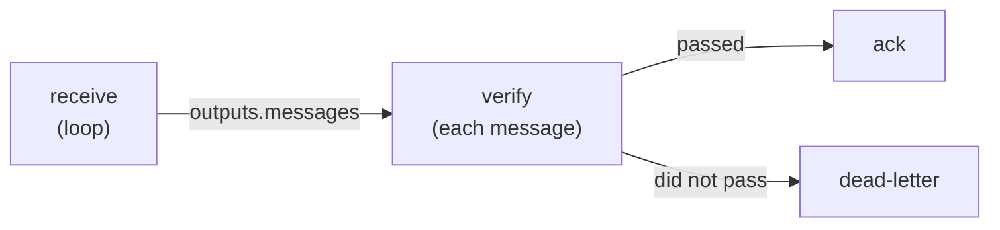

# Serve

`probe serve` keeps running workflows. It runs one on a schedule, as monitoring does, or again and again, as a worker that takes what a queue holds and handles each item. A serve file says which workflows it runs and when:

```bash
probe serve serve.yml
```

Serve knows nothing of what a run does. Each run is a process of `probe` of its own, the run a person gets with the same files and vars, and serve reads what it reports. A queue is whatever a workflow reads, so serve works with any queue, table or mailbox a workflow can reach, and adds nothing to Probe for each of them.

This page shows how the parts fit together. The [CLI reference](/reference/cli-reference#serve) describes every key of the serve file.

## Running on a Schedule

A serve file names each workflow by a name of its own, the files a run of it merges, and when it runs:

```yaml
name: monitoring
description: Check the API every five minutes
workflows:
  health:
    files: [workflows/health.yml]
    schedule: "*/5 * * * *"
    read_only: true
    allow_hosts: [api.example.com]
    timeout: 2m
```

`schedule` is a cron expression, on the clock of the local time zone. `timeout` ends a run that goes on longer, and `read_only` and `allow_hosts` give the run the [guard](/guide/concepts/guard), as a person who runs the workflow sets it on the command line.

Compared with cron running `probe`, serve:

- does not start a workflow again while a run of it is going, and logs that it skipped it
- limits how many runs go at once with `workers`
- keeps what each run reported, and removes old runs after `results.keep`
- writes one line of JSON for each run, which a log collector reads as it is
- stops the runs going when it is stopped, waiting `grace` for them first

Serve notifies no one of a failed run. That is left to the workflow, as an `always` job that posts to Slack or sends mail, the same job that notifies when a person runs it.

## Working Through a Queue

A worker takes the messages a queue holds, handles each, and acknowledges it so that the queue does not give it again. In serve, each of these is a workflow: one receives, one handles an item, and one acknowledges it. Serve passes what one gives to the next.



The workflow that receives gives the messages as an [output of the workflow](/reference/yaml-configuration#outputs), a list of objects. It gives an empty list when the queue is empty, as `?? []` does for a response that leaves the messages out, since a run that passes without a list is logged as an error:

```yaml
name: Receive orders
vars:
  queue_url: "{{QUEUE_URL}}"
jobs:
  - name: Receive
    steps:
      - id: receive
        uses: http
        with:
          url: "{{vars.queue_url}}"
          get: /messages?max=10
        test: res.code == 200
        outputs:
          messages: res.body.messages
outputs:
  messages: outputs.receive?.messages ?? []
```

Each message, such as `{"receipt": "r-81", "order_id": "1042"}`, gives its keys as the vars of the runs for it. The workflow that handles a message reads `vars.order_id`, and knows nothing of the queue, so it can be run by itself, as `probe --var order_id=1042 workflows/verify.yml`:

```yaml
name: Verify an order
vars:
  api_url: "{{API_URL}}"
  order_id: ""
jobs:
  - name: Verify
    steps:
      - uses: http
        with:
          url: "{{vars.api_url}}"
          get: /orders/{{vars.order_id}}
        test: res.code == 200 && res.body.status == "paid"
```

The workflow that acknowledges reads `vars.receipt`. One file can hold both what acknowledges a message and what moves it to a dead letter queue, as jobs that the serve file picks with `jobs`:

```yaml
name: Queue
vars:
  queue_url: "{{QUEUE_URL}}"
  receipt: ""
jobs:
  - id: delete
    name: Delete the message
    steps:
      - uses: http
        with:
          url: "{{vars.queue_url}}"
          delete: /messages/{{vars.receipt}}
        test: res.code == 204
  - id: move
    name: Move the message to the dead letter queue
    steps:
      - uses: http
        with:
          url: "{{vars.queue_url}}"
          post: /dead-letters
          headers:
            content-type: application/json
          body:
            receipt: "{{vars.receipt}}"
        test: res.code == 201
```

The serve file runs the first in a `loop`, and the others by `for_each`:

```yaml
name: orders
description: Verify the orders a queue holds
workflows:
  receive:
    files: [workflows/receive.yml]
    loop: true
    interval: 10s
    for_each:
      items: messages
      workflow: verify
      concurrency: 4
      on_success: ack
      on_failure: dead-letter
  verify:
    files: [workflows/verify.yml]
    timeout: 10m
  ack:
    files: [workflows/queue.yml]
    jobs: [delete]
  dead-letter:
    files: [workflows/queue.yml]
    jobs: [move]
```

`receive` runs again once the messages it gave are handled, after `interval`, so it takes no more than serve can handle. Up to four messages are verified at once. A message whose `verify` passed is acknowledged by `ack`, and one whose `verify` did not pass is moved by `dead-letter`.

Serve handles a message at least once. A message that is neither acknowledged nor moved, because those runs failed or serve was stopped, is given again by the queue once its visibility timeout is over. Write the workflows that handle a message so that handling it twice does no harm.

The messages are read from the report of the run, where the values of the [`secrets`](/reference/yaml-configuration#secrets) are masked. A message that holds one cannot be passed on, so it is skipped and logged, and the queue gives it again. Give a message an ID to look up what is secret, rather than the secret itself.

### One Workflow or Several

A workflow can also take the messages and check each by itself: an [`iteration`](/reference/yaml-configuration#iteration) runs a step once for each entry of what an earlier step found, as `iteration: "{{ outputs.receive.messages }}"`. One workflow is enough when what it takes needs no acknowledgement one by one, as when it checks what a source holds, or when a run that fails may have the queue give every message again. Split it into workflows run by `for_each` when:

- **Each message is acknowledged as it passed or not.** The run of a workflow passes or fails as a whole, and an `iteration` stops at the first entry that fails, so a later step cannot tell which messages to acknowledge and which to move to a dead letter queue. `for_each` runs `on_success` or `on_failure` for each message by how its own run ended.
- **A message is not to hold up the others.** Each message is a run of its own, with its own `timeout`, report and `output.log`: one that hangs or fails leaves the others to go on, and is looked into by itself.
- **The handling and the acknowledgement need another guard.** The guard is given to each workflow, so `verify` can run under `read_only` with `allow_hosts` naming the service it checks, while only `ack` writes to the queue.
- **The handling is to be run without the queue.** `verify.yml` reads only its vars, so a person reproduces a message with `probe --var order_id=1042 workflows/verify.yml`, and CI can run the same check.

The workflows are split by what they do, not by file: `ack` and `dead-letter` above are two jobs of one file.

## Keeping a Cursor

Some sources have no queue that remembers what was taken: the rows of a table after an ID, or the mail of a mailbox after a UID. The workflow that reads them gives where it got to as an output, and serve keeps it as `state` between its runs:

```yaml
name: New orders
vars:
  api_url: "{{API_URL}}"
  cursor: "0"
jobs:
  - name: List
    steps:
      - id: list
        uses: http
        with:
          url: "{{vars.api_url}}"
          get: /orders?after={{vars.cursor}}
        test: res.code == 200
        outputs:
          orders: res.body.orders
          last: res.body.last_id
outputs:
  orders: outputs.list?.orders ?? []
  cursor: outputs.list?.last ?? vars.cursor
```

```yaml
name: new-orders
workflows:
  new-orders:
    files: [workflows/new-orders.yml]
    schedule: "* * * * *"
    state: [cursor]
    for_each:
      items: orders
      workflow: verify
      on_success: none
  verify:
    files: [workflows/verify.yml]
```

The first run reads `cursor` as the workflow gives it, `"0"`. Once a run is over, serve saves the `cursor` it gave, and gives it to the next run as `vars.cursor`. It saves it only when the run passed and every order it gave was handled, so the cursor never moves past an order that was not. An order that fails holds the cursor where it is until it is fixed, and the next run gives it again, with the orders after it that passed, so write `verify` so that verifying an order twice does no harm. An `on_failure` that records the order somewhere lets the cursor move on past it. `on_success: none` says there is nothing to acknowledge.

## Reading the Log

Serve writes a line of JSON to the standard error for each run:

```json
{"time":"2026-11-26T10:15:02Z","level":"INFO","msg":"run","serve":"orders","workflow":"verify","run":"20261126T101500.004211Z-3","from":"20261126T101458.120034Z-2","item":0,"status":"passed","exit_status":0,"started_at":"2026-11-26T10:15:00Z","finished_at":"2026-11-26T10:15:02Z","duration_ms":2104,"report":"/srv/runs/verify/20261126T101500.004211Z-3/report.json","output":"/srv/runs/verify/20261126T101500.004211Z-3/output.log"}
```

- `serve` is the `name` of the serve file, which tells the lines of one serve from those of another.
- `status` is `passed`, `failed`, `error`, `timeout` or `stopped`, and a run that is not `passed` is logged at the level `ERROR`.
- `report` is the [`json` report](/reference/cli-reference#--report) of the run, and `output` is what it printed, the same as a person sees in a terminal.
- `from` and `item` tell which run gave the item and which item it is, and the line of `on_success` or `on_failure` has `for` too, the run of `workflow` it follows.

To see why a run failed, open its `output.log`, or run the workflow again with the same files and vars.

## Running as a Service

Serve runs in the foreground, and is stopped by SIGINT or SIGTERM. It then starts no run, waits `grace` for the runs going, and ends those still going. Under systemd, give the unit `KillMode=mixed`, so that stopping it signals serve, which ends the runs, rather than every process of the unit at once:

```ini
[Unit]
Description=probe serve
After=network-online.target

[Service]
WorkingDirectory=/srv/probe
ExecStart=/usr/local/bin/probe serve serve.yml
EnvironmentFile=/srv/probe/.env
KillMode=mixed
TimeoutStopSec=60
Restart=on-failure

[Install]
WantedBy=multi-user.target
```

Give `TimeoutStopSec` more than `grace`, which is 30 seconds by default, and the 10 seconds serve waits for a run it ended before it kills it, so that systemd does not kill serve while it stops the runs.

A serve file that has `state` is to be served by one serve alone: two would each start from the cursor they read. A queue that hides a message while one worker has it can be served by many.
