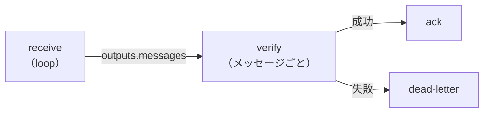

# 常駐実行

`probe serve`は、ワークフローを動かし続けます。監視のように決まった時刻に実行することも、キューにあるものを取り出して1件ずつ処理するワーカーのように、繰り返し実行することもできます。どのワークフローをいつ実行するかは、serveファイルに書きます。

```bash
probe serve serve.yml
```

serveは、実行が何をするかを知りません。1回の実行はそれぞれ独立した`probe`のプロセスで、同じファイルとvarsを渡して人が実行したときと同じものです。serveはその実行が報告したものを読みます。キューとはワークフローが読むものなので、ワークフローが届くキュー、テーブル、メールボックスであれば何でも扱えます。そのためにProbeへ何かを足す必要はありません。

このページでは、各部分がどう組み合わさるかを説明します。serveファイルのすべてのキーは、[CLIリファレンス](/ja/reference/cli-reference#serve)にあります。

## 決まった時刻に実行する

serveファイルには、ワークフローごとに名前を付け、1回の実行がマージするファイルと、実行する時刻を書きます。

```yaml
name: monitoring
description: 5分ごとにAPIを確認する
workflows:
  health:
    files: [workflows/health.yml]
    schedule: "*/5 * * * *"
    read_only: true
    allow_hosts: [api.example.com]
    timeout: 2m
```

`schedule`は、ローカルのタイムゾーンの時計で読むcron式です。`timeout`は、それより長く続く実行を終わらせます。`read_only`と`allow_hosts`は、人がコマンドラインで指定するのと同じように、実行に[ガード](/ja/guide/concepts/guard)を与えます。

cronから`probe`を実行する場合と比べて、serveには次の違いがあります。

- ワークフローの実行が動いている間は、同じワークフローを始めず、見送ったことをログに書きます
- 同時に動かす実行の数を`workers`で制限します
- 各実行が報告したものを残し、`results.keep`を過ぎた古い実行を削除します
- 実行ごとに1行のJSONを書くので、ログの収集ツールがそのまま読めます
- serveを止めると、動いている実行を`grace`の間待ってから止めます

serveは、失敗した実行を誰にも知らせません。それはワークフローの役目です。人が実行したときにも知らせる、Slackへ投稿したりメールを送ったりする`always`のジョブで知らせます。

## キューを処理する

ワーカーは、キューにあるメッセージを取り出し、1件ずつ処理し、キューが同じメッセージを再び渡さないように確認応答（ack）します。serveでは、それぞれがワークフローです。受け取るワークフロー、1件を処理するワークフロー、確認応答するワークフローがあり、serveは前のワークフローが渡したものを次へ渡します。



受け取るワークフローは、メッセージを[ワークフローのoutputs](/ja/reference/yaml-configuration#outputs)として、オブジェクトのリストで渡します。キューが空のときも空のリストを渡します。成功したのにリストを渡さない実行はエラーとして記録されるので、メッセージを省いた応答には`?? []`で空のリストを渡します。

```yaml
name: Receive orders
vars:
  queue_url: "{{QUEUE_URL}}"
jobs:
  - name: Receive
    steps:
      - id: receive
        uses: http
        with:
          url: "{{vars.queue_url}}"
          get: /messages?max=10
        test: res.code == 200
        outputs:
          messages: res.body.messages
outputs:
  messages: outputs.receive?.messages ?? []
```

`{"receipt": "r-81", "order_id": "1042"}`のような各メッセージのキーが、そのメッセージのための実行のvarsになります。メッセージを処理するワークフローは`vars.order_id`を読むだけで、キューのことは知りません。そのため、`probe --var order_id=1042 workflows/verify.yml`のように単独でも実行できます。

```yaml
name: Verify an order
vars:
  api_url: "{{API_URL}}"
  order_id: ""
jobs:
  - name: Verify
    steps:
      - uses: http
        with:
          url: "{{vars.api_url}}"
          get: /orders/{{vars.order_id}}
        test: res.code == 200 && res.body.status == "paid"
```

確認応答するワークフローは`vars.receipt`を読みます。メッセージを確認応答する処理と、デッドレターキューへ移す処理を1つのファイルにジョブとして書き、serveファイルの`jobs`で選ぶこともできます。

```yaml
name: Queue
vars:
  queue_url: "{{QUEUE_URL}}"
  receipt: ""
jobs:
  - id: delete
    name: Delete the message
    steps:
      - uses: http
        with:
          url: "{{vars.queue_url}}"
          delete: /messages/{{vars.receipt}}
        test: res.code == 204
  - id: move
    name: Move the message to the dead letter queue
    steps:
      - uses: http
        with:
          url: "{{vars.queue_url}}"
          post: /dead-letters
          headers:
            content-type: application/json
          body:
            receipt: "{{vars.receipt}}"
        test: res.code == 201
```

serveファイルでは、受け取るワークフローを`loop`で実行し、残りを`for_each`で実行します。

```yaml
name: orders
description: キューにある注文を検証する
workflows:
  receive:
    files: [workflows/receive.yml]
    loop: true
    interval: 10s
    for_each:
      items: messages
      workflow: verify
      concurrency: 4
      on_success: ack
      on_failure: dead-letter
  verify:
    files: [workflows/verify.yml]
    timeout: 10m
  ack:
    files: [workflows/queue.yml]
    jobs: [delete]
  dead-letter:
    files: [workflows/queue.yml]
    jobs: [move]
```

`receive`は、渡したメッセージの処理が済んでから、`interval`だけ待って再び実行します。そのため、serveが処理できる以上には取り出しません。メッセージは同時に4件まで検証します。`verify`が成功したメッセージは`ack`が確認応答し、成功しなかったメッセージは`dead-letter`が移します。

serveは、メッセージを少なくとも1回処理します。その実行が失敗したかserveが止められたために、確認応答も移動もされなかったメッセージは、可視性タイムアウトが過ぎるとキューが再び渡します。メッセージを処理するワークフローは、同じメッセージを2回処理しても問題が起きないように書いてください。

メッセージは実行のレポートから読みます。レポートでは[`secrets`](/ja/reference/yaml-configuration#secrets)の値がマスクされています。シークレットを含むメッセージは次へ渡せないので、スキップしてログに書き、キューが再び渡します。メッセージにはシークレットそのものではなく、シークレットを引くためのIDを持たせてください。

## カーソルを残す

取り出したものを覚えてくれるキューのない取り出し元もあります。あるIDより後のテーブルの行や、あるUIDより後のメールボックスのメールです。それを読むワークフローは、どこまで読んだかをoutputsとして渡し、serveがそれを`state`として実行と実行の間で残します。

```yaml
name: New orders
vars:
  api_url: "{{API_URL}}"
  cursor: "0"
jobs:
  - name: List
    steps:
      - id: list
        uses: http
        with:
          url: "{{vars.api_url}}"
          get: /orders?after={{vars.cursor}}
        test: res.code == 200
        outputs:
          orders: res.body.orders
          last: res.body.last_id
outputs:
  orders: outputs.list?.orders ?? []
  cursor: outputs.list?.last ?? vars.cursor
```

```yaml
name: new-orders
workflows:
  new-orders:
    files: [workflows/new-orders.yml]
    schedule: "* * * * *"
    state: [cursor]
    for_each:
      items: orders
      workflow: verify
      on_success: none
  verify:
    files: [workflows/verify.yml]
```

最初の実行は、ワークフローが与える`cursor`、つまり`"0"`を読みます。実行が終わると、serveはその実行が渡した`cursor`を保存し、次の実行に`vars.cursor`として渡します。保存するのは、実行が成功し、渡したすべての注文の処理が済んだときだけです。そのため、処理の済んでいない注文をカーソルが追い越すことはありません。失敗した注文があると、直るまでカーソルはその場にとどまり、次の実行がその注文を、その後の成功した注文とあわせて再び渡します。そのため`verify`は、同じ注文を2回検証しても問題が起きないように書いてください。失敗した注文をどこかに記録する`on_failure`を書けば、カーソルはその注文を越えて進みます。`on_success: none`は、確認応答するものがないことを表します。

## ログを読む

serveは、実行ごとに1行のJSONを標準エラー出力に書きます。

```json
{"time":"2026-11-26T10:15:02Z","level":"INFO","msg":"run","serve":"orders","workflow":"verify","run":"20261126T101500.004211Z-3","from":"20261126T101458.120034Z-2","item":0,"status":"passed","exit_status":0,"started_at":"2026-11-26T10:15:00Z","finished_at":"2026-11-26T10:15:02Z","duration_ms":2104,"report":"/srv/runs/verify/20261126T101500.004211Z-3/report.json","output":"/srv/runs/verify/20261126T101500.004211Z-3/output.log"}
```

- `serve`はserveファイルの`name`で、あるserveの行を別のserveの行と見分けられます。
- `status`は`passed`、`failed`、`error`、`timeout`、`stopped`のいずれかで、`passed`でない実行はレベル`ERROR`で書きます。
- `report`は実行の[`json`レポート](/ja/reference/cli-reference#--report)、`output`は実行が出力したもので、人が端末で見るものと同じです。
- `from`と`item`は、どの実行が渡した何番目の要素かを表します。`on_success`や`on_failure`の行には、どの`workflow`の実行に続くものかを表す`for`もあります。

実行が失敗した理由を調べるには、その`output.log`を開くか、同じファイルとvarsでワークフローをもう一度実行します。

## サービスとして動かす

serveはフォアグラウンドで動き、SIGINTかSIGTERMで止まります。止まるときは新しい実行を始めず、動いている実行を`grace`の間待ち、まだ動いているものを終わらせます。systemdで動かす場合は、ユニットに`KillMode=mixed`を指定してください。停止のシグナルがユニットのすべてのプロセスに同時に届くのではなくserveに届き、serveが実行を終わらせます。

```ini
[Unit]
Description=probe serve
After=network-online.target

[Service]
WorkingDirectory=/srv/probe
ExecStart=/usr/local/bin/probe serve serve.yml
EnvironmentFile=/srv/probe/.env
KillMode=mixed
TimeoutStopSec=60
Restart=on-failure

[Install]
WantedBy=multi-user.target
```

`TimeoutStopSec`は、`grace`（既定は30秒）に、終わらせた実行を強制終了する前に待つ10秒を足したより長くしてください。serveが実行を止めている間に、systemdがserveを強制終了しないためです。

`state`を持つserveファイルは、1つのserveだけで動かしてください。2つで動かすと、それぞれが自分の読んだカーソルから始めてしまいます。あるワーカーが持っている間メッセージを隠すキューであれば、複数のserveで処理できます。
