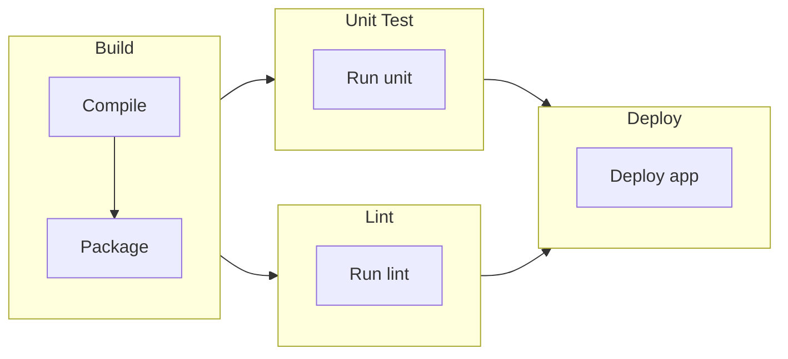

# CLIリファレンス

このページでは、すべてのコマンド、オプション、使用パターンを含む、Probeコマンドラインインターフェイスの完全なドキュメントを提供します。

## 基本的な使用法

Probeの呼び出し方は2つです。実行するワークフローファイルを渡すか、ファイルに対するサブコマンドを指定します。

```bash
probe [options] <workflow-file>...
probe <subcommand> [options] <file>
```

## コマンド構文

実行時には必ず1つ以上のワークフローファイルを指定します。オプションはファイルの前、後、間のどこにでも置けます。`--`より後の引数は、`-`で始まるものも含めてすべてファイルとして扱います。実行以外の処理を行う場合は、最初にサブコマンドを指定します。

### 基本コマンド

単一のワークフローファイルを実行：

```bash
probe workflow.yml
```

### ファイルマージ

設定マージでワークフローを実行：

```bash
probe base.yml environment.yml overrides.yml
probe base.yml,environment.yml,overrides.yml
```

ファイルは別々の引数として渡すか、カンマ区切りの1引数として渡します。2つの形は混ぜて使えます。ファイルは左から右に連結され、1つのYAMLドキュメントとして解析されます。複数のファイルで定義されたトップレベルのキーは最後のファイルの値になり、エントリ単位ではなくキーごと置き換わります。

### 位置引数

位置引数はワークフローのパスだけで、1つ以上が必須です。

#### `workflow-path`

**型:** String、1つ以上（必須）  
**説明:** ワークフローYAMLファイル、ディレクトリ、グロブのパス。複数のパスを別々の引数またはカンマ区切りで渡すと、指定した順にマージされます。直接指定するファイルは`.yml`か`.yaml`で終わる必要があります。ディレクトリやグロブからは、これらのファイルだけを読みます

**例:**
```bash
# 単一ファイル
probe workflow.yml

# 複数ファイル（マージ）
probe base.yml production.yml
probe base.yml,production.yml

# 相対パス
probe ./workflows/api-test.yml

# 絶対パス
probe /home/user/workflows/monitoring.yml
```

## コマンドラインオプション

オプションが変えるのは実行内容ではなく結果の出力のしかたです。どれだけ詳細に出力するか、どの形式で出力するか、実行時間を含めるかを指定します。

### `-v, --verbose`

**型:** ブールフラグ  
**デフォルト:** `false`  
**説明:** 詳細な実行情報を表示する詳細出力を有効化

**例:**
```bash
probe -v workflow.yml
probe --verbose workflow.yml
```

**詳細出力に含まれる内容:**
- ステップバイステップの実行詳細
- HTTPリクエスト/レスポンス情報
- テンプレート評価結果
- タイミング情報
- デバッグメッセージ

### `-h, --help`

**型:** ブールフラグ  
**説明:** コマンド使用法ヘルプを表示して終了

**例:**
```bash
probe -h
probe --help
```

### `--version`

**型:** ブールフラグ
**説明:** バージョン情報を表示して終了

**例:**
```bash
probe --version
```

**出力形式:**
```
Probe Version 1.2.3 (commit: abc1234)
```

### `--timing`

**型:** ブールフラグ  
**デフォルト:** `false`  
**説明:** ステップごとの時刻情報（開始時刻とレスポンスタイム）を表示

**例:**
```bash
probe --timing workflow.yml
```

### `--output`

**型:** String  
**値:** `auto`, `spinner`, `stream`  
**デフォルト:** `auto`  
**説明:** レポートの出力方法を選択します。`auto`は対話的な端末なら`spinner`、それ以外なら`stream`を選びます。`spinner`は進捗をその場で描き換え、`stream`は完了したものから順に書き出すため、CIのログやパイプに向いています。

`stream`は、ジョブの実行中にも、ステップの開始と終了ごとに1行を標準エラー出力へ書き出します。ジョブは並行して動くため、各行にはそのジョブの`name`をテンプレートを評価したうえで付けます。`name`に含まれるシークレットはマスクします。`name`のないジョブには`id`を付けます。24桁を超える`name`は切り詰め、同じ`name`のジョブには`id`を添えます。ラベルは同じ幅にそろえるため、ステップの列が縦にそろいます。

```
15:54:13.658 [Unit tests (job_0)] ▸ go test ./api
15:54:13.658 [Unit tests (job_1)] ▸ go test ./web
15:54:13.659 [Deploy staging]     ▸ upload
15:54:13.690 [Unit tests (job_1)] ✓ go test ./web (31ms)
15:54:13.702 [Unit tests (job_0)] ✗ go test ./api
```

値は環境変数`PROBE_OUTPUT`でも指定できます。優先順位はフラグ、環境変数、自動判定の順です。

**例:**
```bash
probe --output stream workflow.yml
probe --output=spinner workflow.yml
PROBE_OUTPUT=stream probe workflow.yml
```

### `--report`

**型:** String  
**値:** `format[=path]`をカンマで区切った並び。`format`は`json`、`junit`、`markdown`、`github-summary`のいずれか  
**デフォルト:** なし（レポートファイルは書き出さない）  
**説明:** すべてのジョブが終わったあと、実行結果をファイルに書き出します。端末に出るレポートは変わりません。

パスを省いた形式は、カレントディレクトリの既定のファイルに書き出します。パスの親ディレクトリは必要に応じて作成します。同じ形式は一度しか指定できません。既存のファイルは置き換え、そのパーミッションを保ちます。新しいファイルはumaskが許可するパーミッションになります。カレントディレクトリの中を指すパスに書き出すとき、シンボリックリンクをたどってカレントディレクトリの外のファイルに書き込むことはありません。ファイル自体がシンボリックリンクならリンクを置き換えてたどらず、途中のディレクトリが外を指すシンボリックリンクなら拒否します。そのため、チェックアウトしたプロジェクトにシンボリックリンクが置かれていても、レポートが別の場所のファイルに書き出されることはありません。カレントディレクトリの外を指すパス（絶対パスや`..`を含むパス）は、指定どおりの場所に書き出します。

| 形式 | 既定のファイル | 内容 |
|---|---|---|
| `json` | `probe-report.json` | 実行全体。状態、所要時間、ジョブとステップの状態ごとの集計、そして各ステップの`id`、`test`、OpenAPIドキュメントでレスポンスを対応付けた先（`contract`）、失敗した場合はその理由とリクエスト・レスポンス |
| `junit` | `probe-junit.xml` | ジョブごとに`testsuite`、ステップ、`repeat.test`、`repeat.baseline_test`ごとに`testcase`を持つJUnit XML。テスト結果を読めるCI向け |
| `markdown` | `probe-report.md` | 要約の1行、ジョブの表、繰り返したステップの応答時間の表、[`--baseline`](#--baseline)からの変化の表、失敗したステップ、失敗した`repeat.test`、失敗した`repeat.baseline_test`ごとの節 |
| `github-summary` | `$GITHUB_STEP_SUMMARY` | `markdown`と同じページを、GitHub Actionsのジョブサマリーに追記 |

`github-summary`は上書きせずに追記します。先行するステップやほかのツールも同じサマリーに書き込むためです。`GITHUB_STEP_SUMMARY`が設定されておらずパスも指定されていない場合、つまりGitHub Actionsの外では、警告を出して書き出しを飛ばし、終了コードは変えません。同じコマンドラインをCIでも手元でも使えます。GitHubが受け付けるサマリーは1ステップあたり1MiBまでです。ページがそれを超えそうな場合はリクエストとレスポンスを省き、それでも大きすぎる場合は失敗したステップの区切りで打ち切り、その旨を書き添えます。先行するステップの書き込みで空きがまったく残っていない場合は、何も書かずに警告を出します。書き込んでしまうと上限を超え、先行するステップが書いた内容まで失われるためです。パスを明示した場合は、ほかの形式と同じく親ディレクトリを作成します。サマリーは置き換えずに追記するため、明示したパスも同じようにカレントディレクトリの中で解決し、外を指すシンボリックリンクは拒否します。`GITHUB_STEP_SUMMARY`のパスはそのまま使います。

ステップの状態は`passed`、`failed`、`skipped`、そして`test`がなく、OpenAPIドキュメントなどほかに検証するものもないまま実行された場合の`untested`のいずれかです。失敗したステップには次のどれかの理由が記録されます。

| 種類 | 意味 | JUnitの要素 |
|---|---|---|
| `assertion` | `test`式がfalseになった | `<failure>` |
| `test_error` | `test`式を評価できなかった | `<error>` |
| `test_type` | `test`式の結果が真偽値ではなかった | `<error>` |
| `action` | 接続の拒否など、アクションがエラーを返した | `<error>` |
| `template` | ステップの`with`、`vars`、`name`のテンプレートを評価できず、アクションを実行しなかった | `<error>` |
| `contract_response` | OpenAPIドキュメントなど、アクションが照合した契約にレスポンスが違反した | `<failure>` |
| `refused` | `--read-only`など、実行のガードがステップの操作を拒否した | `<error>` |
| `contract_request` | アクションが照合した契約にリクエストが違反した。OpenAPIドキュメントが許可しないものをワークフローが送った | `<error>` |

`repeat`付きのジョブのステップは、1回でも失敗すれば失敗として扱い、成功した回数と、最初に失敗した回の理由を記録します。あわせて、アクションにかかった時間の分布を記録します。`json`では`latency`として、数えた回数、最小値、平均値、最大値、50、90、95、99パーセンタイルを、ミリ秒単位で記録します。`markdown`の表には、平均値を除く同じ項目を載せます。アクションが時間を返した回はすべて数え、テストが失敗した回も含みます。アクションを実行できなかった回と、ステップがスキップされた回は数えません。パーセンタイルは最近接順位法によるもので、指定した割合の回がその時間以内に収まった時間を表します。そのため、値は必ず実際にかかった時間のどれかになります。`repeat.warmup`の回はどちらにも数えず、`json`ではその回数を`warmup`として記録します。[`repeat.test`](/ja/reference/yaml-configuration#全回に対するテスト)のあるジョブは、そのテストだけで成否が決まります。ステップは各回の結果では失敗しません。`json`ではテストをジョブの`repeat_test`として記録し、その`status`と、失敗した場合は`failure`を含めます。`failure`の種類は`assertion`、`test_error`、`test_type`のいずれかです。[`repeat.baseline_test`](/ja/reference/yaml-configuration#以前の実行と比べるテスト)のあるジョブは、同じ形でそれを`baseline_test`として記録します。評価しなかった場合は、`status`を`skipped`とし、その理由を`reason`に記録します。アクションがレスポンスに`dump: false`を設定した場合は、端末と同じくレポートにもリクエストとレスポンスを含めません。

値は環境変数`PROBE_REPORT`でも指定でき、フラグのほうが優先されます。書き出せないレポートファイルがあっても残りは書き出し、Probeは終了ステータス2で終わります。

**例:**
```bash
probe --report junit workflow.yml
probe --report json=out/report.json,junit=out/junit.xml,markdown=out/summary.md workflow.yml
PROBE_REPORT=markdown probe workflow.yml
```

### `--baseline`

**型:** String  
**値:** 以前の実行が`--report json`で書き出したレポートのパス  
**デフォルト:** なし  
**説明:** 端末とレポートファイルで、繰り返したステップの応答時間を以前の実行と比べます。比較そのものでは、ジョブの成否と終了ステータスは変わりません。[`repeat.baseline_test`](/ja/reference/yaml-configuration#以前の実行と比べるテスト)のあるジョブは、そのテストで以前の実行と比べて検証します。

ステップは、以前のレポートのうち、`id`が同じジョブにある`id`が同じステップと比べます。`id`のないステップは、`step_1`のように`step_`とジョブ内の位置になります。そのため、前にステップを追加すると別のステップとして扱われます。比べるステップには`id`を付けてください。1つのジョブに同じ`id`のステップが複数ある場合（イテレーションの各エントリーなど）は、順に対応させます。Probeがステップの`id`を記録する前に書き出したレポートとは比べられません。

端末では、繰り返したステップの時間の下に、以前の実行のp50、p95、p99と、今回の値がそこからどれだけ変わったかを`baseline p50 120ms (+12.5%), p95 270ms, p99 300ms (-10.0%)`のように示します。`markdown`と`github-summary`には、アクションが時間を返したステップの表が入ります。回数、p50、p95、p99、成功した回の割合を、それぞれ「以前の値 → 今回の値」の形で示し、時間には変化の割合を添えます。以前の実行にないステップには`no baseline`と示します。どちらでも、表示上の値に表れないほど小さな変化には割合を付けません。`json`では、ステップの以前の結果を`repeat`の下の`baseline`として`total`、`success`、`latency`で記録し、比べた実行をレポートの`baseline`として`run_id`と`started_at`で記録します。JUnitには比較を載せませんが、`repeat.baseline_test`は`repeat.test`と同じく1つの`testcase`になります。

ファイルは実行の前に読みます。読めないファイルやJSONのレポートでないファイルを指定した場合は、ジョブを実行せずに終了ステータス2で終わります。値は環境変数`PROBE_BASELINE`でも指定でき、フラグのほうが優先されます。

**例:**
```bash
probe --report json=main.json workflow.yml
# 変更の後
probe --report json,markdown --baseline main.json workflow.yml
```

### `--read-only`

**型:** Boolean  
**デフォルト:** false  
**説明:** 書き込みになりうる操作を拒否します。AIエージェントが書いたワークフローなどを、変更してはならないシステムに対して実行するときに使います。

`--read-only`、`--allow-host`、`--allow-action`の3つで、実行のガードを構成します。ガードはProbeを実行する人が指定するもので、ワークフローの側からは緩められません。何を許可するかは各アクションが判定し、Probeは、実行にかかっているガードの種類すべてに従うと宣言したアクションだけをガードの下で実行します。拒否されたステップは種類`refused`で失敗し、終了ステータスは2です。各アクションが何を拒否するかと、外部アクションが従うガードをどう宣言するかは、[ガード](/ja/guide/concepts/guard)を参照してください。

`--read-only=false`で無効にできます。値は環境変数`PROBE_READ_ONLY`（`true`または`1`）でも指定でき、フラグを指定すれば常にフラグのほうが優先されます。

**例:**
```bash
probe --read-only --allow-host api.staging.example.com workflow.yml
```

### `--allow-host`

**型:** String  
**値:** ホストのカンマ区切りのリスト。名前かアドレスで、`localhost:8080`のようにポートを付けるか、付けずに任意のポートを許可するか、`*.example.com`で`example.com`の下の名前を指定します  
**デフォルト:** なし（任意のホスト）  
**説明:** 指定したホスト以外への接続を拒否します。名前は大文字と小文字を区別せずに比較します。どのアクションがこれに従うかは[ガード](/ja/guide/concepts/guard)を参照してください。

値は環境変数`PROBE_ALLOW_HOSTS`でも指定できます。フラグを指定すれば常にフラグのほうが優先されるため、`--allow-host=`は任意のホストを許可します。

### `--allow-action`

**型:** String  
**値:** アクション名のカンマ区切りのリスト。ステップが`uses`に書く名前です。外部アクションは完全な形で指定し、ワークフローが[`actions`](/ja/reference/yaml-configuration#actions)で付けた名前は使えません  
**デフォルト:** なし  
**説明:** ガードに従うと宣言していないアクションでも、`--read-only`や`--allow-host`の下で実行します。Probeを実行する人が信頼する準備用の`shell`などに使います。指定したアクションにもガードは伝えますが、アクションはそのまま実行されます。

値は環境変数`PROBE_ALLOW_ACTIONS`でも指定できます。フラグを指定すれば常にフラグのほうが優先されるため、`--allow-action=`はどのアクションも許可しません。

**例:**
```bash
probe --read-only --allow-action shell workflow.yml
```

### `--var`

**型:** String（繰り返し指定可）  
**値:** `name=value`  
**説明:** ワークフローのvarを、ワークフローが[`vars`](/ja/reference/yaml-configuration#vars)に書いた値の代わりに与えます。値は最初の`=`より後ろのすべてで、空でも構いません。

```bash
probe --var url=https://staging.example.com --var retries=5 workflow.yml
```

- 値はそのまま使われます。値の中の`{{ }}`はテンプレートではなく文字です。varは、環境変数から読んだ値と同じく文字列になります。
- `base: "{{vars.url}}/api"`のように、与えたvarを読む別のvarは、与えた値を読みます。
- ワークフローが書いていない名前も、与えることで定義されます。ステップで`vars.<name>`を読み、値は実行する人に任せるワークフローが書けます。
- 同じ名前を複数回与えた場合は、最後の値になります。名前はトップレベルのvarの名前です。`--var auth.user=x`は`auth`の`user`ではなく、`auth.user`という名前のvarを与えます。

この方法で与えた値は、[`secrets`](/ja/reference/yaml-configuration#secrets)に書いた値のようにレポートで伏せられることはなく、コマンドラインは同じマシンの他のユーザーから見えます。認証情報は環境変数か`--env-file`で渡してください。

### `--env-file`

**型:** String（繰り返し指定可）  
**値:** ファイルのカンマ区切りのリスト  
**説明:** `NAME=value`の行が並んだファイルから変数を読みます。多くのツールがプロジェクトに置く`.env`ファイルの形式です。ワークフローはこれらを、環境変数を読むのと同じように[`vars`](/ja/reference/yaml-configuration#vars)に読み込みます。`"{{API_URL}}"`は環境変数`API_URL`を読み、環境にない場合はファイルから読みます。

```bash
probe --env-file .env workflow.yml
probe --env-file .env,.env.local workflow.yml
```

```bash
# .env
API_URL=https://staging.example.com
API_TOKEN="a value with spaces, \n for a newline"   # コメント
export REGION=tokyo
PRIVATE_KEY='taken as it is, $ and \ included'
```

- 環境にある変数はファイルより優先されます。シェルやCIが設定した値はそのまま使われます。ファイル同士では、後から読んだファイルの値が優先されます。
- ファイルの変数は`vars`のためだけのものです。Probe自身の環境にも、実行するアクションの環境にも設定されません。ファイルから`PROBE_ALLOW_ACTIONS`や`--report github-summary`の書き込み先といったProbe自身の設定は変えられず、`shell`ステップが実行するコマンドからも見えません。コマンドに必要な値は、`env: {API_TOKEN: "{{vars.token}}"}`のようにステップの`env`で渡します。
- 引用符のない値は前後の空白を取り除き、空白かタブの後の`#`で終わります。そこからがコメントです。二重引用符の中では`\n`、`\t`、`\"`、`\\`がエスケープになり、値は複数行にわたれます。単一引用符の中では何も解釈しません。
- 展開は行いません。値の中の`$OTHER`はその文字のままです。
- 存在しないファイルや`NAME=value`でない行があると、Probeはワークフローを読む前に終了ステータス2で停止します。

表示してはいけない値を持つ変数は、通常どおり[`secrets`](/ja/reference/yaml-configuration#secrets)に書きます。値の出どころは関係ありません。

### `--job`

**型:** String（繰り返し指定可）  
**値:** ジョブのidまたは名前のカンマ区切りのリスト  
**説明:** ワークフローのうち、指定したジョブと、それが必要とするジョブだけを実行します。ジョブは`id`で指定します。その`id`を持つジョブがなければ、書かれたとおりの`name`で指定します。`id`のないジョブには、3番目のジョブなら`job_2`のように、位置から決まるidが付きます。`name`はテンプレートを評価する前の、書かれたとおりの文字列と照合します。そのため、`Setup {{vars.env}}`のようにテンプレートを含む`name`のジョブは`id`で指定します。

```bash
probe --job tests workflow.yml
probe --job "User API" --job tests,lint workflow.yml
```

```
Running 3 of 5 jobs: Tests, Setup (needed), Cleanup (always)
```

- 指定したジョブの[`needs`](/ja/reference/yaml-configuration#needs)にあるジョブは、その前に実行します。それらが必要とするジョブも、何段先でも同様です。ジョブはそれらが公開する値を読むことがあるためです。
- [`always`](/ja/reference/yaml-configuration#always)を持つジョブは、`needs`のジョブのどれかが実行されるときに実行します。そのジョブが作ったものを削除するジョブは、実行されなければならないためです。待つのは`needs`のうち実行されるジョブだけで、ほかのジョブは実行しません。そのため、実行されないジョブが公開するはずだった値はありません。`needs`のジョブが失敗したときと同じです。
- それ以外のジョブは実行しません。端末のレポートにも、レポートファイルにも、その集計にも含めません。実行は、実行するジョブだけからなるワークフローの実行です。終了ステータスもそれらのジョブで決まります。どのジョブをなぜ実行するかは、上の行のように標準エラー出力に表示します。ワークフロー全体の実行と取り違えないためです。`json`は、指定したジョブのidとワークフローのジョブの数を`"selection": {"jobs": ["tests"], "total": 5}`のように`selection`に記録します。`markdown`と`github-summary`は要約の行の下にそのことを書き、[`probe coverage`](#coverage)は、ほかのジョブのステップを数えていないことを警告します。
- 外部アクションの取得と、[`embedded`](/ja/reference/actions/embedded)ステップのジョブファイルの読み込みは、実行するジョブの分だけ行います。ワークフロー全体の読み込みと検査は、全体を実行するときと同じく行います。どのジョブであっても、存在しないジョブを指す`needs`、循環する`needs`、どのアクションも指さない`uses`があれば、Probeは終了ステータス2で停止します。
- どのジョブの`id`でも`name`でもない値や、複数のジョブが持つ`name`を指定すると、Probeはジョブを実行する前に終了ステータス2で停止します。近い名前のジョブがあれば候補を示し、複数のジョブが持つ名前では、それらのidを示します。
- カンマを含む名前はカンマで分割されます。そのジョブは`id`で指定します。

`--report`とは異なり、環境変数はありません。一部のジョブに絞る設定が環境から入ると、全体を実行したように見えるためです。

[`probe dag --job`](#dag)は、同じ`--job`での実行が実行するジョブを描きます。

## サブコマンド

サブコマンドを指定すると、ワークフローの実行の代わりに別の処理を行います。`gen`は雛形のワークフローを生成し、`dag`はワークフローが表す依存関係のグラフを出力し、`check`はワークフローを実行せずに誤りや弱点を見つけ、`coverage`は実行がOpenAPIドキュメントのどこまでを検証したかを示し、`guide`はこのドキュメントを出力し、`skill`はAIエージェントがProbeを使えるように準備し、`manifest`は外部アクションのリリースの`action.yml`を出力します。

### `gen`

OpenAPI仕様からprobeワークフローYAMLを生成します。

**使い方:**
```bash
probe gen <openapi-file>
```

**例:**
```bash
probe gen petstore.yml
```

### `dag`

ワークフローを実行せずにジョブ依存関係グラフを表示します。デフォルトではASCIIアートで出力します。`--mermaid`を指定するとMermaidフローチャート形式で出力します。

複数のファイルは、実行時と同じくマージされます。

**使い方:**
```bash
probe dag <workflow-file>...
probe dag --mermaid <workflow-file>...
probe dag --job <job> <workflow-file>...
```

**オプション:**

| オプション | 説明 |
|--------|-------------|
| `--mermaid` | ASCIIアートの代わりにMermaidフローチャート形式で出力 |
| `--job` | 同じ[`--job`](#--job)での実行が実行するジョブだけを描く |

`needs`が循環するジョブは、実行と同じく拒否します。描く順序がないため、終了ステータス2で停止します。

**ASCII出力例:**
```
╭───────────────────────╮
│         Setup         │
├───────────────────────┤
│ ○ Initialize          │
╰───────────┬───────────╯
            │
            │
            ↓
╭───────────────────────╮
│         Build         │
├───────────────────────┤
│ ○ Compile             │
│ ○ Package             │
╰───────────┬───────────╯
            │
            ├──────────────────────────┐
            ↓                          ↓
╭───────────────────────╮  ╭───────────────────────╮
│        Test A         │  │        Test B         │
├───────────────────────┤  ├───────────────────────┤
│ ○ Run tests           │  │ ○ Run tests           │
╰───────────────────────╯  ╰───────────────────────╯
```

**Mermaid出力例 (`--mermaid`):**


以下の用途に便利です：
- 実行前にワークフロー構造を可視化
- ジョブ依存関係とそのステップの理解
- ジョブ依存関係の設定をデバッグ
- ドキュメントやダイアグラムの生成
- Markdownファイルへの埋め込み

### `check`

ワークフローを実行せずに、誤りや弱点を見つけます。人やAIエージェントが書いたワークフローを、テスト対象のシステムに対して実行する前に確かめられます。実行時と同じく複数のファイルを読み合わせる場合は、別々の引数として渡すか、カンマ区切りで1つの引数として渡します。

**使い方:**
```bash
probe check workflow.yml
probe check base.yml staging.yml
```

**出力例:**
```
workflow.yml:10: error: job 0 "Users", step 0 "Log in": unknown key "tset"; did you mean "test"?
workflow.yml:14: error: job 0 "Users", step 1 "Read": unknown action "htp"; did you mean "http"?
workflow.yml:18: error: job 0 "Users", step 1 "Read": with: outputs.login.tokn is not published: step "login" publishes token
workflow.yml:21: error: job 0 "Users", step 1 "Read": test: steps is not defined; it can read outputs, repeat_index, report, req, res, rt, status and vars; what an earlier step publishes is read under outputs
workflow.yml:39: warning: job 1 "Other", step 0 "Reads users": with: outputs.login.token may not be published yet: job "Other" does not need job "Users", whose step publishes it
workflow.yml:40: warning: job 1 "Other", step 0 "Reads users": with: vars.api_url is not defined by the workflow, so it is nil unless --var gives it; did you mean "API_URL"?

4 errors, 2 warnings
```

**エラー**として報告するもの:

- ワークフロー、ジョブ、ステップ、`retry`、`repeat`が受け付けないキー。実行時は無視されます。後に読むファイルのためにYAMLのアンカーを持つキーは対象外です
- `name`がない、IDが重複しているなど、実行時に読み込みを拒否されるもの
- 組み込みでも外部でもないアクション、解析できない外部アクションの指定
- ステップの`with`やジョブの`defaults`にある、組み込みアクションが受け付けないキー。アクションはそれを無視します（`body`のつもりの`bdoy`など）。また、どのアクションの名前でもない`defaults`。どのステップにも効きません。確かめるのは直下のキーだけで、`headers`のようなマップの中のキーは確かめません。テンプレートを含むキー、外部アクション、どんなキーも受け付ける`hello`は対象外です
- どのジョブも指していない`needs`、循環する`needs`
- 実行時に拒否されるステップID
- 解析できない式（`test`、`skipif`、`outputs`、`repeat.test`、`repeat.baseline_test`）とテンプレート（`name`、`with`、`vars`、`echo`）
- そのジョブにないステップや、`steps`の下にないフィールドを読む`repeat.test`（`success_rate`のつもりの`steps.search.rate`など）。`steps`や`baseline.steps`の下で同じものを読むか、`baseline`の下の`steps`以外を読む`repeat.baseline_test`
- `baseline`を読む`repeat.test`。`baseline`を読めるのは`repeat.baseline_test`だけ
- `baseline.steps`の下のステップやフィールドを、`baseline.steps[vars.id]`のように実行時に決まるキーで読む`repeat.baseline_test`
- どのステップも公開していない出力、そのステップが公開していない出力、そのステップが公開する前に読む出力（同じジョブの前のステップから読む場合など）の参照
- 式やテンプレートが読む名前のうち、読める場所にないもの。読んだところで失敗します。ステップの`name`、`with`、`vars`、`iteration`、`test`、`echo`ではステップが失敗し、`skipif`、`wait`、出力ではエラーを表示してそれを無視するので、ステップは書いていないかのように実行されます。ステップが読めるのは`vars`、`outputs`、`res`、`req`、`rt`、`status`、`report`、`repeat_index`なので、ステップの`test`の`steps.login.code`、`nil`のつもりの`null`、ステップの`with`の`{{API_TOKEN}}`を報告します。環境変数を読めるのはワークフローの`vars`だけです。繰り返すジョブのテストが読めるのは`vars`、`steps`、`baseline`です。ジョブの`name`とワークフローの`vars`のテンプレートは、この確認の対象外です

**警告**として報告するもの:

- 読む側のジョブが直接にも間接にも`needs`で指定していないジョブの出力の参照。まだ公開されていないかもしれません
- 何も検証していないステップ。`test`がなく、httpアクションの`openapi`やgrpcアクションの`proto`のように契約との照合をアクションに求めてもおらず、ジョブの`repeat.test`と`repeat.baseline_test`のどちらも読んでいないもの
- `1 == 1`のように何も読まない`test`。ステップの実行結果によらず、テストの結果が変わりません
- `baseline`の下を何も読まない`repeat.baseline_test`。`repeat.test`に書けます
- `vars.<name>`として読むvarのうち、ワークフローの`vars`、ステップの`vars`、ステップに書いた`iteration`の項目のどれも定義していないもの。[`--var`](#--var)で与えない限りnilになります。ステップの`vars`が読めるのはワークフローのvarだけなので、ステップの他のvarや`iteration`のキーを読むものも報告します。`vars[k]`のように実行時に決まるキーで読むvarと、`iteration`がテンプレートのステップで、そのステップの`vars`と`iteration`以外のフィールドが読むvarは確かめません。読み合わせるファイルは1つのワークフローとして確かめるので、実行時に読むファイルを`probe check`にも渡します

エラーが見つかれば終了ステータスは2、警告だけか何も見つからなければ0です。

### `fmt`

ワークフローファイルを整形します。`gofmt`がGoを整形するのと同じで、ワークフローの書き方は1通りに決まっており、設定はありません。変えるのは空行、インデント、行の中の空白、コメントだけで、ファイルの内容は変えません。値は引用符も含めて書かれたままです。

**使い方:**
```bash
probe fmt workflow.yml           # ファイルをその場で整形する
probe fmt probe/ base.yml        # ディレクトリの下のすべてのYAMLファイルと、1つのファイル
probe fmt --check probe/         # 何も変えずに、整形されていないファイルを示す
probe fmt - < workflow.yml       # 標準入力を整形して標準出力に書く
```

変更したファイルのパスを1行ずつ出力します。すでに整形されているファイルについては何も出力しません。ディレクトリを渡すと、その下にあるすべての`.yml`と`.yaml`ファイルが対象になります。ただし、名前がドットで始まるディレクトリの下は除きます。パスで直接渡したファイルは、名前にかかわらず整形します。

整形されたワークフローは次のようになります。

```yaml
name: Users API
description: Creates a user and reads it back

vars:
  url: "{{URL ?? 'http://localhost:8080'}}"

jobs:
- name: Create
  id: create
  steps:
  - name: Post a user
    uses: http
    with:
      post: "{{vars.url}}/users" # the body is sent as JSON
      body:
        name: probe
    test: res.code == 201
  # the list is read after the user is there
  - name: List users
    uses: http
    with:
      get: "{{vars.url}}/users"
    test: res.code == 200

- name: Report
  needs: [create]
  steps:
  - uses: hello
```

規則は次のとおりです。

- **空行**: ファイルの最上位のキーは、隣り合う2つのどちらかが、次の行以降に書いたマッピングかシーケンスを持つときに、空行1行で区切ります。そのため`name`と`description`は続けて並びます。何行にわたるスカラーも、`secrets: [API_TOKEN]`のように括弧で書いたコレクションも、これには当たりません。ジョブとジョブの間も空行1行で区切ります。空行はこれだけです。ステップの間にも、ファイルの先頭と末尾にも空行は置きません。`|`ブロックの中の空行のように、スカラーに含まれる空行は値の一部なので残します。
- **インデント**: 1段につきスペース2つです。シーケンスはキーの下で字下げしません。ジョブの`-`は`jobs`と同じ桁に、ステップの`-`は`steps`と同じ桁に置きます。`|`や`>`のブロックの行は、キーからスペース2つ下げた桁で始めます。
- **コメント**: 1行を占めるコメントは、その次の行と同じ桁に置きます。次の行より深く書かれたコメントは、それを最後の行とするブロックの桁に置きます。行末のコメントは、スペース1つを空けて置きます。どちらも`#`の後ろにスペースを1つ入れるので、`#note`は`# note`になります。1行目の`#!`はそのままです。
- **空白**: キーと値の間、`-`と要素の間はスペース1つです。行末に空白は残さず、ファイルは改行1つで終わります。

改行なしで`|`ブロックのまま終わるファイルでは、その値も改行なしで終わっています。ファイルの末尾に改行を足しても値が変わらないように、そのブロックのヘッダーを`|-`に書き換えます。

`--check`を付けると、ファイルを書き換えません。整形されていないファイルのパスを出力し、1つでもあれば終了ステータス1で終わるので、CIでの検査に使えます。標準入力に対しては何も出力しません。

YAMLとして読めないファイルと、存在しないパスに対しては、終了ステータス2で終わります。読めないファイルはそのまま残し、ほかのファイルは整形します。

### `coverage`

実行が`--report json`で書き出したレポートから、OpenAPIドキュメントのオペレーションとレスポンス、または`.proto`ファイルのメソッドのうち、どれをステップが検証したかを示します。httpアクションが`openapi`でレスポンスをドキュメントと照合したステップと、grpcアクションが`proto`で呼び出しをファイルと照合したステップを、成功したかどうかにかかわらず数えます。

**使い方:**
```bash
probe --report json workflow.yml
probe coverage openapi.yml probe-report.json
probe coverage proto/users.proto probe-report.json
```

**出力例:**
```
Coverage of openapi.yml

✓ GET /users/{id} (2 steps)
    ✓ 200 (2 steps)
    - 404
- DELETE /users/{id}
    - 204
✓ GET /items (1 step)
    ✓ default (1 step)

Operations: 2 of 3 checked (66.7%)
Responses:  2 of 4 checked (50.0%)
```

ドキュメントが宣言する各オペレーションを、宣言するレスポンス（`200`、`2XX`、`default`など）とともに一覧にします。ステップのレスポンスを対応付けたものには`✓`、どのステップも対応付けなかったものには`-`を付けます。オペレーションが宣言していないステータスコードのステップは、オペレーションだけに数えます。ステップは、指定したドキュメントを同じパスで指しているときに数えます。`./openapi.yml`のように書き方が違っても同じパスなら数えます。どのステップも指定したドキュメントを指していないレポートはエラーになり、ステップが指しているドキュメントを一覧で示します。`.proto`で終わるファイルは、grpcアクションの契約として扱います。インポートは解決せずにそのファイルだけを読み、宣言している各サービスの各メソッドを`users.v1.UserService/GetUser`のように一覧にします。`.proto`ファイルはメソッドが返すステータスを宣言しないため、網羅度はメソッドだけで示し、レスポンスの行は出しません。ファイルは`proto.files`と同じパスで指定します。

[`--job`](#--job)で絞った実行のレポートには、実行したジョブのステップしかありません。その場合は`[WARN] 3 of the 5 jobs of the workflow ran, selected with --job: tests; the steps of the others are not counted`のように標準エラー出力に警告します。

網羅の度合いにかかわらず終了ステータスは0で、ドキュメントかレポートを読めない場合は2です。

### `guide`

リファレンスとコンセプトのドキュメントを、1ページずつMarkdownで出力します。ページはバイナリに組み込まれているため、オフラインでも使え、実行中のProbeのバージョンに対応した内容です。AIエージェントは、ワークフローを書いたり直したりする前にこれを読めます。

**使い方:**
```bash
probe guide            # トピックの一覧
probe guide <topic>    # 1ページを出力
```

| トピック | ページ |
|---|---|
| `yaml`、`cli`、`functions`、`env`、`actions` | YAMLの設定、CLI、組み込み関数、環境変数、アクションの概要 |
| `http`や`shell`などのアクション名 | そのアクションのリファレンス。`actions/http`の形でも指定可能 |
| `concepts/expressions`や`concepts/testing`などの`concepts/<name>` | コンセプトのガイド |

**例:**
```bash
probe guide http | less
probe guide concepts/expressions > expressions.md
```

未知のトピックを指定すると終了ステータス2で終わります。

### `skill`

Claude CodeなどのAIエージェントに、Probeのワークフローの書き方、実行の仕方、失敗の調べ方を教えるAIエージェントスキルを出力またはインストールします。スキルは、YAMLを書く前に`probe guide`を読むこと、間違えやすい規則、そして失敗した実行を終了コードとレポートから読み解く方法をAIエージェントに伝えます。

**使い方:**
```bash
probe skill                    # SKILL.mdを出力
probe skill install            # .claude/skills/probe/SKILL.mdに書き出す
probe skill install <dir>      # <dir>/SKILL.mdに書き出す
```

`install`はディレクトリを作成し、既存の`SKILL.md`を置き換えます。Probeを更新したあとにもう一度実行すれば、スキルも最新になります。レポートファイルと同じく、`SKILL.md`や`.claude`などのディレクトリにあるシンボリックリンクによって、プロジェクトの外に書き出させることはできません。別の場所からスキルを読むAIエージェントには、`probe skill install .agents/skills/probe`のようにそのディレクトリを指定します。リポジトリからスキルをインストールするツール向けに、同じファイルをリポジトリの`skills/probe/SKILL.md`にも置いています。

### `manifest`

[外部アクション](/ja/guide/concepts/actions#外部アクション)の`action.yml`を出力します。新しいアクションの雛形か、リリースのものです。後者は外部アクションのリリースワークフローがコミットします。

**使い方:**
```bash
probe manifest init <owner>/<repo>
probe manifest <tag> <checksums-file> [action-file]
```

#### `manifest init`

新しいアクションの雛形になる`action.yml`を、それを公開するGitHubリポジトリ`<owner>/<repo>`向けに出力します。

```bash
probe manifest init mozership/probe-greet > action.yml
```

アクションの名前はリポジトリ名から先頭の`probe-`を除いたもので、`runs.url`は各プラットフォームの実行ファイルを`<repo>_{os}_{arch}`という名前で指します。これはGoReleaserがアーカイブせずに公開する実行ファイルの名前です。`runs.url`のタグは仮のもので、チェックサムもないため、このコミットのアクションは使えません。どちらも最初のリリースで入ります。説明と`guard`、`params`、`cleanup`は書き入れる箇所として残してあり、それぞれ何のためのものかをコメントで示しています。

#### `manifest <tag>`

リリースの`action.yml`を出力します。

| 引数 | 説明 |
|---|---|
| `tag` | リリースのタグ。`v0.2.0`など。英数字と`.`、`_`、`+`、`-`からなり、英数字で始まるもの |
| `checksums-file` | リリースの実行ファイルのSHA-256ダイジェスト。`sha256sum`やGoReleaserが書き出す形式で、1行は`<digest>  <file>` |
| `action-file` | 元にする`action.yml`。省略すると作業ディレクトリの`action.yml` |

`action-file`を読み、次の2点を変えて出力します。

- `runs.url`のタグを`tag`に置き換えます。`runs.url`はGitHubのリリースアセットのアドレス`https://github.com/<owner>/<repo>/releases/download/<tag>/<asset>`でなければならず、`<asset>`には`{os}`と`{arch}`が1つずつ必要で、その間に`_`など、英小文字でも数字でもない文字が要ります。
- `runs.checksums`を`checksums-file`のダイジェストに置き換えます。ファイル名が、`<asset>`の`{os}`と`{arch}`をプラットフォームに置き換えたものである行を採り、それ以外の行は無視します。`action-file`にあったチェックサムは残しません。

`name`、`description`、`guard`、`params`、`cleanup`は読んだまま出力します。出力はつねに同じ書式で、チェックサムはプラットフォーム順に並びます。`action-file`の先頭にあるコメント行は残し、それ以外のコメントは残しません。

**例:**
```bash
probe manifest v0.2.0 dist/checksums.txt > "$RUNNER_TEMP/action.yml"
cp "$RUNNER_TEMP/action.yml" action.yml
```

読み込むファイルに出力を直接リダイレクトしないでください。Probeが読む前にシェルが`action.yml`を空にします。

リリースできない`action.yml`や、アセットのダイジェストがないチェックサムファイルを指定すると、終了ステータス2で終わり、標準出力には何も出しません。`init`という名前のタグは指定できません。`manifest init`を指すためです。

## 環境変数

以下の環境変数がProbeの動作に影響します。

### `PROBE_OUTPUT`

**型:** String  
**値:** `auto`, `spinner`, `stream`  
**デフォルト:** `auto`  
**説明:** レポートの出力方法。`--output`と同じ値を取り、フラグが指定された場合はそちらが優先されます。

```bash
export PROBE_OUTPUT=stream
probe workflow.yml
```

### `PROBE_REPORT`

**型:** String  
**値:** `format[=path]`をカンマで区切った並び  
**デフォルト:** なし  
**説明:** 書き出すレポートファイル。`--report`と同じ値を取り、フラグが指定された場合はそちらが優先されます。

```bash
export PROBE_REPORT=junit=out/junit.xml
probe workflow.yml
```

### `PROBE_BASELINE`

**型:** String  
**デフォルト:** なし  
**説明:** 応答時間を比べる以前の実行のレポート。`--baseline`と同じ値を取り、フラグが指定された場合はそちらが優先されます。

```bash
export PROBE_BASELINE=main.json
probe --report markdown workflow.yml
```

### `PROBE_READ_ONLY`、`PROBE_ALLOW_HOSTS`、`PROBE_ALLOW_ACTIONS`

**説明:** 実行のガードです。それぞれ`--read-only`、`--allow-host`、`--allow-action`と同じです。`PROBE_READ_ONLY`は、`true`か`1`で書き込みを拒否し、`false`、`0`、空では拒否しません。いずれもフラグのほうが優先されます。

```bash
export PROBE_READ_ONLY=true
export PROBE_ALLOW_HOSTS=api.staging.example.com
probe workflow.yml
```

### `PROBE_MAX_REPEAT_COUNT`

**型:** Integer  
**デフォルト:** `10000`  
**説明:** ジョブの`repeat.count`の上限で、`count`と`warmup`の合計にも適用されます。この値に達する指定をしたワークフローはエラーになります。

```bash
export PROBE_MAX_REPEAT_COUNT=50000
probe load-test.yml
```

### `PROBE_MAX_ATTEMPTS`

**型:** Integer  
**デフォルト:** `10000`  
**説明:** ステップのリトライ`max_attempts`の上限。

```bash
export PROBE_MAX_ATTEMPTS=100
probe workflow.yml
```

### `FORCE_COLOR`

**型:** String  
**値:** `1`  
**説明:** 標準出力が端末でない場合でも色付き出力を強制します。CIのログで色を残したいときに使います。

```bash
FORCE_COLOR=1 probe workflow.yml
```

これら以外の環境変数は、ワークフローの`vars`から名前そのままで参照できます。詳しくは[環境変数](/ja/reference/environment-variables)を参照してください。

## 使用例

以下では1つのファイルを実行する例から始めて、設定のマージ、コンテナ、CIでの実行、定期的な監視までを示します。

### 基本的なワークフロー実行

実行に必要なのはファイルだけです。`-v`を付けると各ステップの詳細が出力されます。

```bash
# 簡単なヘルスチェックを実行
probe health-check.yml

# 詳細出力で実行
probe -v health-check.yml
```

### 環境固有の実行

1つ目のファイルに続けて、別の引数として、またはカンマの後に2つ目のファイルを指定すると、1つ目に上書きマージされます。1つのワークフローで環境を切り替えるにはこの方法を使います。

```bash
# 開発環境
probe workflow.yml,dev.yml

# ステージング環境
probe workflow.yml,staging.yml

# プロダクション環境
probe workflow.yml,prod.yml
```

### 複雑な設定マージ

ファイルは3つ以上でもマージでき、後に書いたものが前のものを上書きします。

```bash
# 複数の設定をレイヤー化
probe base.yml,region-us.yml,environment-prod.yml,team-overrides.yml
```

### CI/CD統合

終了コードに結果が反映されるため、デプロイ用のスクリプトは実行が失敗した時点で止められます。

```bash
#!/bin/bash
# deployment-test.sh

set -e

echo "Running deployment validation..."
probe deployment-validation.yml,${ENVIRONMENT}.yml

echo "Running smoke tests..."
probe smoke-tests.yml,${ENVIRONMENT}.yml

echo "All tests passed!"
```

### スケジュール実行

同じワークフローを定期的に実行すれば監視になります。cronでもsystemdのタイマーでも構いません。

```bash
# 定期監視用のcrontabエントリ
# 5分毎に実行
*/5 * * * * /usr/local/bin/probe /opt/workflows/monitoring.yml >> /var/log/probe.log 2>&1

# systemdタイマーユニット
[Unit]
Description=Probe Monitoring
Requires=probe-monitoring.timer

[Service]
Type=oneshot
ExecStart=/usr/local/bin/probe /opt/workflows/monitoring.yml
User=probe
Group=probe

[Install]
WantedBy=multi-user.target
```

## 終了コード

終了コードは、失敗したかどうかだけでなく、何を調べるべきかを示します。呼び出し側は、テスト対象のバグ、到達できない接続先、ワークフローの誤りを区別できます。

| 終了コード | 意味 | 説明 |
|-----------|---------|-------------|
| `0` | 成功 | すべてのジョブが完了し、すべてのテストが成功 |
| `1` | テストの失敗 | `test`がfalseになった、評価できなかった、または真偽値にならなかった。あるいはステップに必要なテンプレートを評価できなかった、またはhttpアクションが照合したOpenAPIドキュメントにリクエストかレスポンスが違反した |
| `2` | 設定の誤り | ワークフローやコマンドラインが誤っている。ファイルが無い、YAMLが不正、`needs`に未知のジョブ、不正なステップID、解析できない式やテンプレート、時間として読めない`wait`、未知のフラグやレポート形式など。ワークフローの誤りは読み込む時点で見つけ、どのジョブも実行しない。実行のガードがステップを拒否した場合と、レポートファイルを書き出せなかった場合も`2` |
| `3` | アクションのエラー | 接続の拒否やタイムアウトなど、アクションがエラーを返したため、テストを確かめられなかった |

1回の実行で複数の種類の失敗が起きた場合は、`2`、`3`、`1`の順で最初に当てはまるものを返します。接続先が落ちていると、それに対するテストも失敗することが多いため、`1`より`3`を優先します。

`--help`は使い方を表示して`1`で終わります。

### 終了コードの例

呼び出し側のスクリプトは終了コードで処理を分岐します。

```bash
# 何が起きたかで分岐する
probe workflow.yml
case $? in
  0) echo "Workflow succeeded" ;;
  1) echo "A test failed: look at the system under test" ;;
  2) echo "The workflow or command line is wrong" ;;
  3) echo "An action failed: check that the targets are reachable" ;;
esac

# CI/CDパイプラインで使用
probe integration-tests.yml || exit 1
```

## パフォーマンスとリソース使用量

Probeは単一のバイナリで、起動時に用意するランタイムがありません。実行時間の大半は、アクションが応答を待つ時間で決まります。

### メモリ使用量

- **ベースメモリ:** Probeランタイムで約10MB
- **ワークフローあたり:** 複雑さに応じて約1-5MB
- **アクションあたり:** レスポンスサイズに応じて約0.1-1MB

### 実行タイミング

`time`では全体の所要時間が、`--timing`ではステップごとの内訳がわかります。

```bash
# ワークフロー実行時間を計測
time probe workflow.yml

# 詳細モードで詳細なタイミング
probe -v workflow.yml 2>&1 | grep "Execution time"
```

### 並行実行

Probeは可能な場合ジョブを並列実行します：

```bash
# 依存関係のないジョブは同時実行される
# 最大同時実行数は通常システムリソースにより制限される
# 詳細モードで実行パターンを確認
probe -v parallel-workflow.yml
```

## トラブルシューティングコマンド

期待どおりに動かないときは、まずProbeが実際に読み込んだ内容を確認します。以下ではその確認方法と、よく遭遇する問題を示します。

### デバッグ情報

オプションを組み合わせると、実行時に得られる情報をすべて出力できます。`--version`では使用中のバイナリを特定できます。

```bash
# 最大限の情報を出す
probe -v --timing workflow.yml

# バージョンとコミットを確認
probe --version

# 実行せずにジョブの依存関係を確認
probe dag workflow.yml
```

### よくある問題

**ファイルが見つからない:**
```bash
probe: error: workflow file 'missing.yml' not found
# ファイルパスと権限をチェック
ls -la missing.yml
```

**権限拒否:**
```bash
probe: error: permission denied reading 'workflow.yml'
# ファイル権限を修正
chmod 644 workflow.yml
```

**YAML構文エラー:**
```bash
probe: error: YAML syntax error at line 15
# YAML構文を検証
yaml-validator workflow.yml
```

## 統合例

Probeは単一のバイナリで、終了コードで結果を返します。そのためCIからの実行は1ステップで済みます。以下では3つのCIでの書き方を示します。

### GitHub Actions

バイナリの取得を1ステップ、ワークフローの実行を次のステップで行います。

```yaml
name: Probe Tests
on: [push, pull_request]

jobs:
  test:
    runs-on: ubuntu-latest
    steps:
      - uses: actions/checkout@v3
      
      - name: Install Probe
        run: |
          curl -L https://github.com/mozership/probe/releases/latest/download/probe_linux_x86_64.tar.gz | tar -xz probe
          chmod +x probe
          sudo mv probe /usr/local/bin/
      
      - name: Run Tests
        env:
          API_TOKEN: ${{ secrets.API_TOKEN }}
        run: probe --report github-summary workflow.yml,${GITHUB_REF##*/}.yml
```

`--report github-summary`を付けると、失敗したステップを含む結果が実行のサマリーページに表示されます。

### GitLab CI

同じ2つの手順を1つのジョブ定義に収められます。

```yaml
stages:
  - test

probe-test:
  stage: test
  image: alpine:latest
  before_script:
    - apk add --no-cache curl
    - curl -L https://github.com/mozership/probe/releases/latest/download/probe_linux_x86_64.tar.gz | tar -xz -C /usr/local/bin probe
    - chmod +x /usr/local/bin/probe
  script:
    - probe workflow.yml,$CI_ENVIRONMENT_NAME.yml
  variables:
    API_TOKEN: $API_TOKEN
```

### Jenkinsパイプライン

認証情報はJenkinsのクレデンシャルストアから取得し、環境変数としてProbeに渡します。

```groovy
pipeline {
    agent any
    
    environment {
        API_TOKEN = credentials('api-token')
        PROBE_OUTPUT = 'stream'
    }
    
    stages {
        stage('Install Probe') {
            steps {
                sh '''
                    curl -L https://github.com/mozership/probe/releases/latest/download/probe_linux_x86_64.tar.gz | tar -xz probe
                    chmod +x probe
                    sudo mv probe /usr/local/bin/
                '''
            }
        }
        
        stage('Run Tests') {
            steps {
                sh 'probe workflow.yml,${BRANCH_NAME}.yml'
            }
        }
    }
    
    post {
        always {
            archiveArtifacts artifacts: '*.log', allowEmptyArchive: true
        }
    }
}
```

## 高度な使用パターン

以下は1つのファイルを実行するのではなく、多数のワークフローや環境にまたがってProbeを動かす場合のパターンです。

### 設定テンプレート

ファイルのパス自体を環境変数から組み立てれば、環境が変わってもコマンドラインは同じままです。

```bash
# ファイルパスで環境変数を使用
export ENV=production
probe workflow.yml,configs/${ENV}.yml

# 動的ファイル選択
WORKFLOW_FILE=$([ "$ENV" = "prod" ] && echo "prod-workflow.yml" || echo "dev-workflow.yml")
probe $WORKFLOW_FILE
```

### バッチ実行

ディレクトリをループすれば全ワークフローを実行し、失敗したものを記録できます。

```bash
# 複数のワークフローを実行
for workflow in workflows/*.yml; do
  echo "Running $workflow..."
  probe "$workflow" || echo "Failed: $workflow"
done

# 並列実行
find workflows/ -name "*.yml" | xargs -P 4 -I {} probe {}
```

### 監視統合

監視システムが必要とするのは終了コードです。そのため、呼び出し側のスクリプトから結果を転送できます。

```bash
# 監視システムとの統合
probe monitoring.yml
RESULT=$?

if [ $RESULT -ne 0 ]; then
  # 監視システムにアラートを送信
  curl -X POST https://monitoring.example.com/alert \
    -H "Content-Type: application/json" \
    -d '{"message": "Probe workflow failed", "exit_code": '$RESULT'}'
fi
```

## 関連項目

- **[YAML設定](/ja/reference/yaml-configuration)** - 完全なYAML構文リファレンス
- **[アクションリファレンス](/ja/reference/actions/variables)** - 組み込みアクションとパラメータ
- **[環境変数](/ja/reference/environment-variables)** - サポートされているすべての環境変数
- **[ハウツー](/ja/guide/how-tos/api-testing)** - 実用的な使用例
- **[エラーハンドリング戦略](/ja/guide/how-tos/error-handling-strategies)** - よくある問題と解決策
