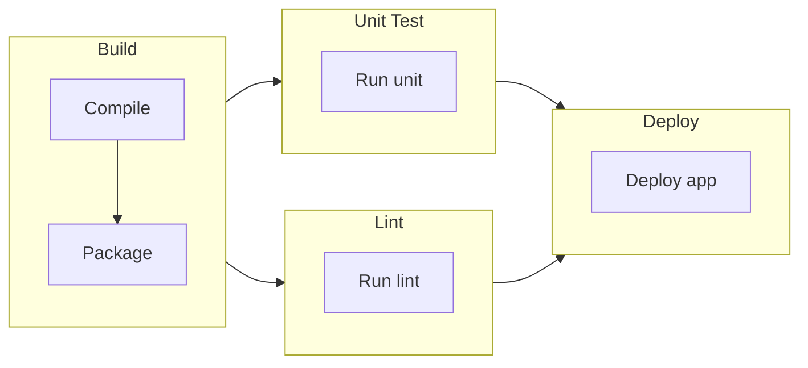

# CLI Reference

This page provides complete documentation for the Probe command-line interface, including all commands, options, and usage patterns.

## Basic Usage

Probe is invoked in one of two forms: a workflow file to run, or a subcommand acting on one.

```bash
probe [options] <workflow-file>...
probe <subcommand> [options] <file>
```

## Command Syntax

Every invocation names one or more workflow files. Options may come before, after or between them, and every argument after `--` is a file, even one that starts with `-`. A subcommand comes first when you want something other than a run.

### Basic Command

Execute a single workflow file:

```bash
probe workflow.yml
```

### File Merging

Execute workflows with configuration merging:

```bash
probe base.yml environment.yml overrides.yml
probe base.yml,environment.yml,overrides.yml
```

The files are given as separate arguments or as one comma-separated argument, and the two forms can be mixed. The files are concatenated from left to right into a single YAML document. A top-level key defined in more than one file takes the value from the last file, and the whole key is replaced rather than merged entry by entry.

### Positional Arguments

The workflow paths are the only positional arguments, and at least one is required.

#### `workflow-path`

**Type:** String, one or more (required)  
**Description:** Path to the workflow YAML file, a directory or a glob. Several paths, as separate arguments or as a comma-separated list, are merged in their order. A file named directly must end in `.yml` or `.yaml`; from a directory or a glob, only those files are read

**Examples:**
```bash
# Single file
probe workflow.yml

# Multiple files (merging)
probe base.yml production.yml
probe base.yml,production.yml

# Relative paths
probe ./workflows/api-test.yml

# Absolute paths
probe /home/user/workflows/monitoring.yml
```

## Command-Line Options

The options change how a run reports itself rather than what it does: how much detail is printed, in what format, and whether timings are included.

### `-v, --verbose`

**Type:** Boolean flag  
**Default:** `false`  
**Description:** Show what each step did: the request its action was given, the response it returned, and how its test went. Give it twice, as `-vv`, to show how each action is run as well

**Example:**
```bash
probe -v workflow.yml
probe --verbose workflow.yml
probe -vv workflow.yml
```

**Verbose Output Includes:**
- The request and the response of each step, and its response time. For a step whose action failed before it returned a request, the parameters the step gave the action, its templates evaluated, in their place
- The result of the test and the values it read (`Env`)
- The records actions log at debug, info and error level, which a run without `-v` leaves out

The verbose output goes to standard error, and the report to standard output as it does without `-v`. Each record an action logs is shown as the rest of the verbose output is, its level and the action first, then its fields:

```
[DEBUG] ./my-action: retrying the request
[DEBUG]   attempt: 2
```

**`-vv`**, or `-v` given twice, also shows what helps to debug an action rather than a workflow: how Probe starts the action's process, calls it and stops it, and the records actions log at trace level, such as the parameters they received and the result they returned. These are left out of `-v`, as the request and the response already show what they would.

```
[TRACE] http: starting plugin
[TRACE]   args:
[TRACE]     - probe
[TRACE]     - builtin-actions
[TRACE]     - http
[TRACE]   path: /usr/local/bin/probe
…
[TRACE] http: plugin exited
```

### `-h, --help`

**Type:** Boolean flag  
**Description:** Show command usage help and exit

**Example:**
```bash
probe -h
probe --help
```

### `--version`

**Type:** Boolean flag
**Description:** Show version information and exit

**Example:**
```bash
probe --version
```

**Output Format:**
```
Probe Version 1.2.3 (commit: abc1234)
```

### `--timing`

**Type:** Boolean flag  
**Default:** `false`  
**Description:** Show timing information (start time and response time) for each step

**Example:**
```bash
probe --timing workflow.yml
```

### `--output`

**Type:** String  
**Values:** `auto`, `spinner`, `stream`  
**Default:** `auto`  
**Description:** Select how the report is rendered. `auto` picks `spinner` on an interactive terminal and `stream` otherwise. `spinner` redraws progress in place, while `stream` writes each result as it completes, which suits CI logs and pipes.

While jobs run, `stream` also writes a line to stderr as each step starts and ends. Jobs run at once, so each line is labelled with the name of its job, with its templates evaluated and the secrets in it masked, or with its `id` when it has no name. A name longer than 24 columns is cut short, jobs with the same name have their `id` added, and the labels are padded to one width so that the steps line up:

```
15:54:13.658 [Unit tests (job_0)] ▸ go test ./api
15:54:13.658 [Unit tests (job_1)] ▸ go test ./web
15:54:13.659 [Deploy staging]     ▸ upload
15:54:13.690 [Unit tests (job_1)] ✓ go test ./web (31ms)
15:54:13.702 [Unit tests (job_0)] ✗ go test ./api
```

The value can also come from the `PROBE_OUTPUT` environment variable. The flag wins over the environment variable, which in turn wins over auto detection.

**Example:**
```bash
probe --output stream workflow.yml
probe --output=spinner workflow.yml
PROBE_OUTPUT=stream probe workflow.yml
```

### `--report`

**Type:** String  
**Values:** a comma separated list of `format[=path]`, where `format` is `json`, `junit`, `markdown` or `github-summary`  
**Default:** none; no report file is written  
**Description:** Write the result of the run to files once every job has finished. The terminal report is unchanged.

A format without a path is written to its default file in the current directory. Parent directories of a path are created as needed, and each format may be given once. An existing file is replaced and keeps its permissions; a new one gets what the umask allows. A path inside the current directory never leads out of it: a symlink at the file is replaced rather than followed, and a symlink on a directory along the way that points outside is refused, so a checked-out project cannot redirect a report to a file elsewhere. A path outside the current directory, absolute or through `..`, is written where it says.

| Format | Default file | Contents |
|---|---|---|
| `json` | `probe-report.json` | The whole run: status, timings, a summary of jobs and steps by status, and every step with its `id`, its test, what its response was matched to in an OpenAPI document as `contract`, and, when it failed, the reason and the request and response; and the [`outputs`](/reference/yaml-configuration#outputs) of the workflow, when it has any |
| `junit` | `probe-junit.xml` | JUnit XML with a `testsuite` per job and a `testcase` per step, per `repeat.test` and per `repeat.baseline_test`, for CI systems that read test results |
| `markdown` | `probe-report.md` | A summary line, a table of jobs, a table of the response times of repeated steps, a table of how they changed from the [`--baseline`](#--baseline), and a section per failed step, per failed `repeat.test` and per failed `repeat.baseline_test` |
| `github-summary` | `$GITHUB_STEP_SUMMARY` | The `markdown` page, appended to the GitHub Actions job summary |

`github-summary` appends rather than overwrites, since earlier steps and other tools write to the same summary. Outside GitHub Actions, where `GITHUB_STEP_SUMMARY` is not set and no path is given, it prints a warning and is skipped without changing the exit code, so one command line serves CI and a local run. GitHub accepts at most 1 MiB of summary per step: when the page would go over, the requests and responses are left out, and if it is still too large the page is cut short at a failed step, with a note saying so. If earlier steps have left no room at all, nothing is written and a warning says so, so that the summary they wrote is not lost. Parent directories of an explicit path are created as for the other formats. An explicit path is kept inside the current directory in the same way, refusing any symlink that leads out, since the summary is appended to rather than replaced; the path in `GITHUB_STEP_SUMMARY` is used as given.

A step's status is `passed`, `failed`, `skipped`, or `untested` when it ran without a `test` and nothing else checked it, such as an OpenAPI document. A step of the hello action, which does nothing that could fail, passes without a `test`. A failed step records one of these reasons:

| Kind | Meaning | JUnit element |
|---|---|---|
| `assertion` | The `test` expression evaluated to false | `<failure>` |
| `test_error` | The `test` expression could not be evaluated | `<error>` |
| `test_type` | The `test` expression did not evaluate to a boolean | `<error>` |
| `action` | The action returned an error, such as a refused connection | `<error>` |
| `template` | A template in the step's `with`, `vars` or `name` could not be evaluated, so the action did not run | `<error>` |
| `contract_response` | The response broke the contract the action checked it against, such as an OpenAPI document | `<failure>` |
| `refused` | The guard of the run, such as `--read-only`, refused what the step was to do | `<error>` |
| `contract_request` | The request broke the contract the action checked it against: the workflow sent what an OpenAPI document does not allow | `<error>` |

A step in a job with `repeat` fails when any iteration fails, and reports how many iterations passed and why the first failing one failed. It also reports the distribution of the times its action took. In `json` it is `latency`: the number of runs it counts, the minimum, mean and maximum, and the 50th, 90th, 95th and 99th percentiles, in milliseconds. The table in `markdown` has the same, but for the mean. It counts every run in which the action returned a time, those whose test failed included; a run in which the action failed to run, or the step was skipped, is not counted. A percentile is by nearest rank, the time that the given share of the runs took at most, so it is always one of the times taken. The runs of `repeat.warmup` are counted in neither, and `json` records their number as `warmup`. A job with [`repeat.test`](/reference/yaml-configuration#test-over-the-runs) passes or fails by that test alone: its steps are not failed by their runs, and `json` records the test as `repeat_test` of the job, with its `status` and, when it failed, its `failure`, of one of the kinds `assertion`, `test_error` or `test_type`. A job with [`repeat.baseline_test`](/reference/yaml-configuration#test-against-an-earlier-run) records it as `baseline_test` in the same way, with the `status` `skipped` and its `reason` when it was not checked. When an action sets `dump: false` on its response, the request and response are left out of the report as they are left out of the terminal.

The value can also come from the `PROBE_REPORT` environment variable, and the flag wins over it. If a report file cannot be written, the others are still written and Probe exits with status 2.

**Example:**
```bash
probe --report junit workflow.yml
probe --report json=out/report.json,junit=out/junit.xml,markdown=out/summary.md workflow.yml
PROBE_REPORT=markdown probe workflow.yml
```

### `--baseline`

**Type:** String  
**Values:** the path of a report an earlier run wrote with `--report json`  
**Default:** none  
**Description:** Compare the response times of the repeated steps, in the terminal and in the report files, to those of the earlier run. The comparison changes neither whether a job passes nor the exit status; a job with [`repeat.baseline_test`](/reference/yaml-configuration#test-against-an-earlier-run) is tested against the earlier run by it.

A step is compared to the step of the same `id`, in the job of the same `id`, in the earlier report. A step without an `id` is `step_` and where it is written in its job, such as `step_1`, so adding a step before it makes it another step; give the steps compared an `id`. When a job has several steps of one `id`, as the entries of an iteration have, they are compared in order. A report written before Probe recorded the `id` of steps has none to compare to.

The terminal shows under the times of each repeated step its p50, p95 and p99 in the earlier run, and how much this run's changed from them, as `baseline p50 120ms (+12.5%), p95 270ms, p99 300ms (-10.0%)`. `markdown` and `github-summary` have a table of the steps whose action returned times, with the runs, p50, p95, p99 and the share of the runs that succeeded, each as the earlier value → this run's, and how much the times changed. A step the earlier run has none of is marked `no baseline`. In both, a change too small to show in the times as they are written gets no share. `json` records the earlier outcome of a step as `baseline` under its `repeat`, with `total`, `success` and `latency`, and the run compared to as `baseline` of the report, with its `run_id` and `started_at`. JUnit has no comparison, but a `repeat.baseline_test` is a testcase of its own, as `repeat.test` is.

The file is read before the run, and a file that cannot be read or is not a JSON report ends Probe with status 2 before any job runs. The value can also come from the `PROBE_BASELINE` environment variable, and the flag wins over it.

**Example:**
```bash
probe --report json=main.json workflow.yml
# after the change
probe --report json,markdown --baseline main.json workflow.yml
```

### `--read-only`

**Type:** Boolean  
**Default:** false  
**Description:** Refuse what writes, so that a workflow, such as one a coding agent wrote, can be run against a system it must not change.

`--read-only`, `--allow-host` and `--allow-action` make up the guard of a run. Whoever runs Probe sets it, and nothing in a workflow can loosen it. Each action decides what the guard allows, and Probe runs an action under a guard only when the action declares every kind of it the run is under; a step that is refused fails with the kind `refused`, which exits with status 2. See [Guard](/guide/concepts/guard) for what each action refuses, and how an external action declares the guard it keeps to.

`--read-only=false` turns it off. The value can also come from the `PROBE_READ_ONLY` environment variable, `true` or `1`, and the flag wins over it whenever it is given.

**Example:**
```bash
probe --read-only --allow-host api.staging.example.com workflow.yml
```

### `--allow-host`

**Type:** String  
**Values:** a comma separated list of hosts: a name or an address, with a port, such as `localhost:8080`, or without one for any port, or `*.example.com` for the names under `example.com`  
**Default:** none; any host  
**Description:** Refuse connecting to any host but these. Names are compared without regard to case. See [Guard](/guide/concepts/guard) for which actions keep to it.

The value can also come from the `PROBE_ALLOW_HOSTS` environment variable, and the flag wins over it whenever it is given, so that `--allow-host=` allows any host.

### `--allow-action`

**Type:** String  
**Values:** a comma separated list of action names, as a step writes them in `uses`; an external action in full, not a name the workflow gives it under [`actions`](/reference/yaml-configuration#actions)  
**Default:** none  
**Description:** Run these actions under `--read-only` or `--allow-host` although they do not declare that they keep to the guard, such as `shell` for a setup step the person running Probe trusts. They are told the guard, and are run as they are.

The value can also come from the `PROBE_ALLOW_ACTIONS` environment variable, and the flag wins over it whenever it is given, so that `--allow-action=` allows none.

**Example:**
```bash
probe --read-only --allow-action shell workflow.yml
```

### `--var`

**Type:** String, can be repeated  
**Values:** `name=value`  
**Description:** Give a var of the workflow, in place of what the workflow writes for it under [`vars`](/reference/yaml-configuration#vars). The value is everything after the first `=`, and may be empty.

```bash
probe --var url=https://staging.example.com --var retries=5 workflow.yml
```

- The value is taken as it is: a `{{ }}` in it is text, not a template, and the var is a string, as one read from the environment is.
- A var that reads the one given, as `base: "{{vars.url}}/api"`, sees the value given.
- A name the workflow does not write is defined by being given, so a step can read `vars.<name>` and the workflow leave its value to whoever runs it.
- A name given more than once has the value given last. The name is that of a top-level var: `--var auth.user=x` gives a var named `auth.user`, not the `user` of `auth`.

A value given this way is not hidden from the report as one named under [`secrets`](/reference/yaml-configuration#secrets) is, and a command line can be read by other users of the machine. Give a credential through the environment or `--env-file`.

### `--vars-file`

**Type:** String  
**Values:** the path of a file, or `-` for the standard input  
**Description:** Give vars of the workflow as a JSON object of them by name, read from a file or from the standard input, as a program that runs Probe gives them without putting them on the command line.

```bash
probe --vars-file vars.json workflow.yml
echo '{"body": "{\"order\": 42}", "receipt": "AQEB..."}' | probe --vars-file - workflow.yml
```

- Each var is given as one given with [`--var`](#--var) is. A string is the value as it is; a number, a boolean, an object or a list is its JSON, which a step reads back with `parse_json`, and a number is as it is written, so that `1.50` stays `1.50`.
- A var whose value is `null` is not given, and the workflow's own value is used.
- A name is taken without the white space around it, as `--var` takes it.
- What is read must be a single JSON object, which may start with the byte order mark some editors write, and every var in it needs a name of its own. Anything else, such as a name given twice, stops Probe with status 2 before any job runs.
- A name given with `--var` too has the value of `--var`.
- `--vars-file` can be given once.

As with `--var`, a value given this way is not hidden from the report as one named under [`secrets`](/reference/yaml-configuration#secrets) is.

### `--env-file`

**Type:** String, can be repeated  
**Values:** a comma separated list of files  
**Description:** Read variables from files of `NAME=value` lines, as the `.env` files many tools keep beside a project, for the workflow to read into its [`vars`](/reference/yaml-configuration#vars) as it reads the environment: `"{{API_URL}}"` reads `API_URL` from the environment, and from the files when the environment has none.

```bash
probe --env-file .env workflow.yml
probe --env-file .env,.env.local workflow.yml
```

```bash
# .env
API_URL=https://staging.example.com
API_TOKEN="a value with spaces, \n for a newline"   # a comment
export REGION=tokyo
PRIVATE_KEY='taken as it is, $ and \ included'
```

- A variable the environment has wins over a file, so that what a shell or CI sets is kept. Among the files, the last to give a variable wins.
- The files are for the `vars` alone. They are not set in the environment of Probe or of the actions it runs: a file cannot change Probe's own settings, such as `PROBE_ALLOW_ACTIONS` or where `--report github-summary` writes, and a command a `shell` step runs does not see them. Give a command what it needs through the step's `env`, as `env: {API_TOKEN: "{{vars.token}}"}`.
- A value without quotes has the spaces around it removed, and ends at a `#` that comes after a space or a tab, which starts a comment. In double quotes, `\n`, `\t`, `\"` and `\\` are escapes, and the value may go on over several lines. In single quotes nothing is.
- Nothing is expanded: `$OTHER` in a value is those characters.
- A file that does not exist, or a line that is not `NAME=value`, stops Probe before the workflow is read, with exit status 2.

A variable whose value must not be shown is named under [`secrets`](/reference/yaml-configuration#secrets) as usual; where the value comes from makes no difference.

### `--job`

**Type:** String, can be repeated  
**Values:** a comma separated list of job ids or names  
**Description:** Run only these jobs of the workflow, with the jobs they need. A job is named by its `id`, or by its `name` as written when no job has that `id`. A job without an `id` has the one its place gives it, such as `job_2` for the third job. A `name` is matched as it is written, before its templates are evaluated, so a job whose `name` has a template, such as `Setup {{vars.env}}`, is selected by its `id`.

```bash
probe --job tests workflow.yml
probe --job "User API" --job tests,lint workflow.yml
```

```
Running 3 of 5 jobs: Tests, Setup (needed), Cleanup (always)
```

- The jobs in the [`needs`](/reference/yaml-configuration#needs) of a selected job run before it, and those they need, however far down, since a job may read what they publish.
- A job with [`always`](/reference/yaml-configuration#always) runs when a job it needs runs, as the job that removes what that job made has to. It waits for those of its `needs` that run, and does not bring the others, so it runs without what they would have published, as it does after one of them failed.
- The other jobs are not run, and are not in the terminal report, the report files or their counts: the run is that of a workflow of the jobs that run. The exit status is theirs. The line above, on the standard error, says which jobs run and why, so that the run is not taken for one of the whole workflow. `json` records the jobs selected, by id, and how many jobs the workflow has, as `selection`, as `"selection": {"jobs": ["tests"], "total": 5}`; `markdown` and `github-summary` say so under the summary line, and [`probe coverage`](#coverage) warns that the steps of the other jobs are not counted.
- The external actions and the job files of an [`embedded`](/reference/actions/embedded) step are fetched and read for the jobs that run alone. The whole workflow is still read and checked as it is for a run of it: a need that is no job, needs in a cycle, or a `uses` that names no action, in any job, stops Probe with exit status 2.
- A value that is no job's `id` or `name`, or a `name` that several jobs have, stops Probe before any job runs, with exit status 2. A name close to one of a job is suggested; a name several jobs have is told by their ids.
- A name that has a comma in it is split at the comma: select its job by its `id`.

There is no environment variable for it, as there is for `--report`: a run set to some of the jobs from the environment would look like a run of them all.

[`probe dag --job`](#dag) draws the jobs a run with the same `--job` runs.

## Subcommands

A subcommand replaces the run with something else: `gen` writes a starting workflow, `dag` prints the dependency graph a workflow describes, `check` finds what is wrong or weak in a workflow without running it, `coverage` tells how much of an OpenAPI document a run checked, `guide` prints this documentation, `skill` sets up a coding agent to use Probe, `manifest` writes the `action.yml` of a release of an external action, and `licenses` prints the licenses a release has to carry.

### `gen`

Generate probe workflow YAML from an OpenAPI specification.

**Usage:**
```bash
probe gen <openapi-file>
```

**Example:**
```bash
probe gen petstore.yml
```

### `dag`

Display job dependency graph without executing the workflow. By default, outputs ASCII art. Use `--mermaid` to output in Mermaid flowchart format.

Several files are merged as a run merges them.

**Usage:**
```bash
probe dag <workflow-file>...
probe dag --mermaid <workflow-file>...
probe dag --job <job> <workflow-file>...
```

**Options:**

| Option | Description |
|--------|-------------|
| `--mermaid` | Output in Mermaid flowchart format instead of ASCII art |
| `--job` | Draw only the jobs a run with the same [`--job`](#--job) runs |

Jobs whose `needs` are in a cycle, which a run refuses, have no order to be drawn in, and stop it with exit status 2.

**ASCII Output Example:**
```
╭───────────────────────╮
│         Setup         │
├───────────────────────┤
│ ○ Initialize          │
╰───────────┬───────────╯
            │
            │
            ↓
╭───────────────────────╮
│         Build         │
├───────────────────────┤
│ ○ Compile             │
│ ○ Package             │
╰───────────┬───────────╯
            │
            ├──────────────────────────┐
            ↓                          ↓
╭───────────────────────╮  ╭───────────────────────╮
│        Test A         │  │        Test B         │
├───────────────────────┤  ├───────────────────────┤
│ ○ Run tests           │  │ ○ Run tests           │
╰───────────────────────╯  ╰───────────────────────╯
```

**Mermaid Output Example (`--mermaid`):**


This is useful for:
- Visualizing workflow structure before execution
- Understanding job dependencies and their steps
- Debugging job dependency configurations
- Generating documentation with rendered diagrams
- Embedding in Markdown files for automatic rendering

### `check`

Find what is wrong or weak in a workflow without running it, so that a workflow written by hand or by a coding agent can be checked before it reaches the systems it tests. Several files read together, as a run reads them, are given as separate arguments or as one comma-separated argument.

**Usage:**
```bash
probe check workflow.yml
probe check base.yml staging.yml
```

**Output Example:**
```
workflow.yml:10: error: job 0 "Users", step 0 "Log in": unknown key "tset"; did you mean "test"?
workflow.yml:14: error: job 0 "Users", step 1 "Read": unknown action "htp"; did you mean "http"?
workflow.yml:18: error: job 0 "Users", step 1 "Read": with: outputs.login.tokn is not published: step "login" publishes token
workflow.yml:21: error: job 0 "Users", step 1 "Read": test: steps is not defined; it can read job, notes, outputs, repeat_index, report, req, res, rt, status and vars; what an earlier step publishes is read under outputs
workflow.yml:39: warning: job 1 "Other", step 0 "Reads users": with: outputs.login.token may not be published yet: job "Other" does not need job "Users", whose step publishes it
workflow.yml:40: warning: job 1 "Other", step 0 "Reads users": with: vars.api_url is not defined by the workflow, so it is nil unless --var gives it; did you mean "API_URL"?

4 errors, 2 warnings
```

It reports as an **error**:

- a key a workflow, job, step, `retry` or `repeat` does not take, which a run ignores; a key that holds a YAML anchor for the files read after it is not one
- what a run refuses to load, such as a missing `name` or a duplicate id
- an action that is neither built in nor external, and an external action that cannot be parsed
- a key of a step's `with`, or of a job's `defaults`, that the built-in action does not take, which it ignores, such as `bdoy` for `body`; and `defaults` for a name no action has, which apply to no step. Only the keys directly under them are checked, not those of a map such as `headers`; a key that holds a template, an external action and `hello`, which takes any key, are not
- a value of a key of a step's `with`, or of a job's `defaults`, that takes only some values and that its built-in action does not take, such as `op: remove` of the file action, which takes `read`, `write`, `append` or `delete`, or `protocol: quic` of the dns action. The keys checked are `op` of the file action, `protocol` of the dns action and `starttls` of the smtp action; the protocol of dns and `starttls` are taken in any case. An external action declares such keys by the `choices` of its [`action.yml`](/guide/concepts/actions#actionyml). A number or a boolean is compared as the text the action is given, and the spaces around a value are left out. A value that holds a template, which is known only when it runs, and an empty one, which leaves the key to its default, are not checked
- a step whose `with`, with the `defaults` merged into it, lacks a key its built-in action cannot run without, such as `host` of the ssh action, or the method of the http action, which `method` or a shorthand such as `get` gives. A step whose `with` has a key that holds a template is not checked
- a field of `res` or `req` that a step's `test`, `echo` or `outputs` read and that its built-in action never returns, which reads nil, such as `res.status_code` of the http action, whose status code is `res.code`. `res.rawbody`, which the runner adds to an action with a body, and `res.json`, which it adds to one with `stdout`, are fields too, and the `res` of a step of the hello action is the keys of its `with` and `status` and `dump`, and its `req` the keys of its `with`. Only the top level is checked, as what is under a field, such as `res.body`, is data; a field read by a key known only when it runs, such as `res[k]`, is not checked
- `res` or `req` read in a step's `name`, `with`, `vars`, `iteration`, `wait` or `skipif`, which are evaluated before the step runs and read them empty
- a `needs` that names no job, and `needs` that go round
- a step id a run refuses
- an expression in `test`, `skipif`, `outputs`, `repeat.test` or `repeat.baseline_test`, or a template in `name`, `with`, `vars` or `echo`, that does not parse. An expression written as a template, as `test: "{{ res.code == 200 }}"`, is told to be written without `{{ }}`
- a `repeat.test` that reads a step its job does not have, or a field a step does not have under `steps`, such as `steps.search.rate` for `success_rate`, and a `repeat.baseline_test` that does so under `steps` or `baseline.steps`, or reads anything under `baseline` other than `steps`
- a `repeat.test` that reads `baseline`, which only `repeat.baseline_test` can
- a `repeat.baseline_test` that reads a step or a field under `baseline.steps` by a key known only when it runs, such as `baseline.steps[vars.id]`
- an output read that no step publishes, that its step does not publish, or that is read before its step publishes it, such as by an earlier step of the job
- a name an expression or a template reads that is not there to read, which fails where it is read: in a step's `name`, `with`, `vars`, `iteration`, `test` or `echo` the step fails, and a `skipif`, a `wait` or an output that reads it is reported and left out, so the step runs as if it were not written. A step reads `vars`, `outputs`, `res`, `req`, `rt`, `status`, `report`, `repeat_index`, `notes` and `job`, so `steps.login.code` in a step's `test`, `null` for `nil`, or `{{API_TOKEN}}` in a step's `with`, as the environment is read only by the workflow's `vars`, is reported. The tests of a repeated job read `vars`, `steps` and `baseline`. The templates of a job's `name` and of the workflow's `vars` are not checked for this
- an expression or a template that is sure to go wrong by the kinds of the values it reads: an operator given values it does not take, such as `"id-" + 1`, which fails, where `"id-" + string(1)` joins them as text; a comparison of values that are never equal, such as `res.code == "200 OK"`, as the status code of the http action is a number, and the status line is `res.status`; and a `test`, `skipif`, `repeat.test` or `repeat.baseline_test` that comes to a value other than true or false, such as `test: res.code`, which fails the step, or leaves the step or the job unskipped. The kinds known are those of what an expression writes, such as `1` and `"id-"`, of what the functions of expressions return, such as `len()`, of what a step reads besides `res` and `req`, such as `status` and `rt.sec`, and of the fields of `res` and `req` each built-in action declares, such as `res.code` and `res.status` of the http action. `vars`, which [`--var`](#--var) gives as text, `outputs`, what is under a field, such as `res.body`, and the fields of an external action may hold anything, so what reads them is not checked; nor are `and` and `or`, which, given a value other than true or false, come to it rather than fail. A number is checked as one, whole or not, so what fails only for a number with a fraction, such as `rt.sec % 1`, is not reported

It reports as a **warning**:

- an output read from a job that is not needed, directly or through others, by the job that reads it, so that it may not be published yet
- an output whose value cannot be read as it is meant to be: one that a step without an id publishes under a name another step publishes too, so that it cannot be read at all; `outputs.<name>` read by itself while more than one step publishes the name, which holds the value of the step that publishes it first; and one named as the id of a step that publishes, so that `outputs.<name>` is that step's outputs or the value, whichever is published first. A value each step publishes under the same name, read through the step's id as `outputs.<id>.<name>`, is not warned of
- a step that nothing checks: it has no `test`, it is not a step of the hello action, which does nothing that could fail, the action is not asked to check it against a contract, as `openapi` asks the http action and `proto` the grpc action, and neither the `repeat.test` nor the `repeat.baseline_test` of its job reads it
- a field of `res` that a step of an external action reads and that the `res` of its `action.yml` does not declare. An action whose `action.yml` declares no `res` is not checked
- a `test` that reads nothing, such as `1 == 1`, which gives the same result whatever the step does
- a `repeat.baseline_test` that reads nothing under `baseline`, which can go in `repeat.test`
- a var read as `vars.<name>` that neither the workflow's `vars`, nor the step's `vars`, nor the entries of an `iteration` written in the step define, which reads nil unless [`--var`](#--var) gives it. A step's own `vars` read only those of the workflow, so one that reads another var of the step, or a key of its `iteration`, is reported too. A var read by a key known only when it runs, such as `vars[k]`, and, in a step whose `iteration` is a template, the vars its other fields read, are not checked. Files read together are checked as one workflow, so give `probe check` the files the run reads

It exits with status 2 when it finds an error, and with 0 when it finds only warnings or nothing.

### `fmt`

Format workflow files, as `gofmt` formats Go: there is one way a workflow is laid out, and nothing to configure. It changes only blank lines, indentation, the spaces of a line and comments, never what a file says: a value is left as it is written, quotes and all.

**Usage:**
```bash
probe fmt workflow.yml           # format a file in place
probe fmt probe/ base.yml        # every YAML file under a directory, and a file
probe fmt --check probe/         # change nothing, and tell what is not formatted
probe fmt - < workflow.yml       # format the standard input to the standard output
```

It prints the path of each file it changed, and nothing for a file that was formatted already. A directory is every `.yml` and `.yaml` file under it, apart from those under a directory whose name starts with a dot. A file given by its path is formatted whatever its name.

A formatted workflow:

```yaml
name: Users API
description: Creates a user and reads it back

vars:
  url: "{{URL ?? 'http://localhost:8080'}}"

jobs:
- name: Create
  id: create
  steps:
  - name: Post a user
    uses: http
    with:
      post: "{{vars.url}}/users" # the body is sent as JSON
      body:
        name: probe
    test: res.code == 201
  # the list is read after the user is there
  - name: List users
    uses: http
    with:
      get: "{{vars.url}}/users"
    test: res.code == 200

- name: Report
  needs: [create]
  steps:
  - uses: hello
```

The rules:

- **Blank lines.** One blank line separates the keys at the top of the file when either of two that meet holds a mapping or a sequence written on the lines under it, so `name` and `description` stay together, and one separates each job from the next. A scalar, however many lines it takes, and a collection written in brackets, such as `secrets: [API_TOKEN]`, are not such. There is no other blank line: none between steps, and none at the start or the end of the file. The blank lines of a scalar, such as those of a `|` block, are part of it and are kept.
- **Indentation.** Two spaces for each level, and a sequence is not indented under its key: the `-` of a job is at the column of `jobs`, and that of a step at the column of `steps`. The lines of a `|` or `>` block start two spaces in from their key.
- **Comments.** A comment on a line of its own is indented as the line it comes before, or as the block it ends when it is written deeper than what follows it. A comment at the end of a line is a single space from it. Each has a space after its `#`, so `#note` becomes `# note`; a `#!` on the first line is kept.
- **Spaces.** A key is a single space from its value, and a `-` from its entry. No line ends in a space, and the file ends in a single newline.

A file that ended in a `|` block without a newline ended in a value without one. So that the value stays the same once the file ends in a newline, the header of the block becomes `|-`.

With `--check`, no file is written. It prints the path of each file that is not formatted and exits with status 1 when there is one, which makes it a check for CI. For the standard input it prints nothing.

It exits with status 2 for a file that is not YAML, which is left as it is while the others are still formatted, and for a path that does not exist.

### `coverage`

Tell which operations and responses of an OpenAPI document, or which methods of a `.proto` file, the steps of a run checked, from the report the run wrote with `--report json`. A step counts when the http action checked its response against the document with `openapi`, or the grpc action checked its call against the file with `proto`, whether the step passed or not.

**Usage:**
```bash
probe --report json workflow.yml
probe coverage openapi.yml probe-report.json
probe coverage proto/users.proto probe-report.json
```

**Output Example:**
```
Coverage of openapi.yml

✓ GET /users/{id} (2 steps)
    ✓ 200 (2 steps)
    - 404
- DELETE /users/{id}
    - 204
✓ GET /items (1 step)
    ✓ default (1 step)

Operations: 2 of 3 checked (66.7%)
Responses:  2 of 4 checked (50.0%)
```

Each operation the document declares is listed with the responses it declares, such as `200`, `2XX` or `default`, marked `✓` when a step's response was matched to it and `-` when none was. A step whose status code the operation does not declare counts for the operation alone. Steps count for the document given when they name it by the same path, written in another way such as `./openapi.yml` too; a report whose steps name none of them is an error that lists those they name. A file ending in `.proto` is taken for the grpc action's contract. It is read on its own, without its imports, and each method of each service it declares is listed, such as `users.v1.UserService/GetUser`. A `.proto` file declares no statuses its methods end with, so its coverage is told by methods alone, without the line for responses. Name the file as `proto.files` does.

A report of a run narrowed with [`--job`](#--job) has the steps of the jobs that ran alone; coverage warns of it on the standard error, as `[WARN] 3 of the 5 jobs of the workflow ran, selected with --job: tests; the steps of the others are not counted`.

It exits with status 0 whatever the coverage, and with 2 when the document or the report cannot be read.

### `guide`

Print a page of the reference and concept documentation as Markdown. The pages are built into the binary, so they work offline and describe the version of Probe that is running. A coding agent can read them before it writes or fixes a workflow.

**Usage:**
```bash
probe guide            # list the topics
probe guide <topic>    # print one page
```

| Topics | Pages |
|---|---|
| `yaml`, `cli`, `functions`, `env`, `actions` | The YAML configuration, the CLI, the built-in functions, the environment variables, and the overview of actions |
| The name of a built-in action, such as `http` or `shell` | That action's reference. `actions/http` works too |
| The name of an official [external action](#external-actions), such as `slack` | The action's description, read from its repository at its latest release |
| `concepts/<name>`, such as `concepts/expressions` or `concepts/testing` | The concept guides |

**Example:**
```bash
probe guide http | less
probe guide concepts/expressions > expressions.md
```

An unknown topic exits with status 2.

#### External Actions

`probe guide` also prints the description of an [external action](/guide/concepts/actions#external-actions), which it reads from the action, not from Probe: the `README.md` of the directory of its `action.yml`, or, for an action that has none, the name, the description, `params` and `res` its `action.yml` declares.

```bash
probe guide <action> [workflow-file]
```

| `<action>` | What it reads |
|---|---|
| `./tools/my-action`, `../x` or an absolute path | The local action in that directory, taken from the working directory |
| `github.com/<owner>/<repo>[/<dir>]` | The action at its latest release: the last commit of the default branch that changed its `action.yml`, which the release workflow of an action commits with the digests of each release |
| `github.com/<owner>/<repo>[/<dir>]@<commit SHA>` | The action at that commit |
| A name under [`actions`](/reference/yaml-configuration#actions) of `workflow-file` | The action the workflow runs by that name, at the commit it pins, and a local one taken from the directory of the workflow |

A name is looked for under `actions` of the workflow first, then among the topics built into Probe, and then among the external actions published alongside Probe, which `probe guide` lists under a heading of their own: the name `slack` is `github.com/mozership/probe-slack`, read at its latest release. Their pages are not built into Probe, so a release of an action is printed without a release of Probe. The first lines say where the page comes from, and that it is written by the authors of the action, not by Probe. For an action on GitHub they give the `uses` line that pins it:

```bash
probe guide github.com/mozership/probe-slack
```

````markdown
> The action github.com/mozership/probe-slack at its latest release. What follows is its README.md at that commit, written by the authors of the action, not by Probe. Pin it as:

```yaml
uses: github.com/mozership/probe-slack@<commit SHA> # <tag>
```

---

# probe-slack
...
````

A line warns when the `action.yml` of the commit found as the latest release downloads another release than the latest, as after a commit that changed it without a release. The latest release is found with the REST API of GitHub, with the token in `GITHUB_TOKEN` when it is set; without one, GitHub allows 60 requests an hour. What an action holds at a commit is kept under `probe/actions/docs` in the user's cache directory, and read again from there offline. An action that cannot be read, or whose `action.yml` is not that of a Probe action, exits with status 2.

### `skill`

Print or install the agent skill that teaches a coding agent, such as Claude Code, to write, run and debug Probe workflows. The skill tells the agent to read `probe guide` before writing YAML, lists the rules that are easy to get wrong, and explains how to read a failed run from its exit code and report.

**Usage:**
```bash
probe skill                    # print SKILL.md
probe skill install            # write .claude/skills/probe/SKILL.md
probe skill install <dir>      # write <dir>/SKILL.md
```

`install` creates the directory and replaces an existing `SKILL.md`, so running it again after upgrading Probe brings the skill up to date. As with report files, a symlink in the project, at `SKILL.md` or on a directory such as `.claude`, cannot make it write outside the project. For an agent that reads skills from another place, give that directory, for example `probe skill install .agents/skills/probe`. The same file is in the repository at `skills/probe/SKILL.md` for tools that install skills from a repository.

### `manifest`

Print the `action.yml` of an [external action](/guide/concepts/actions#external-actions): the one to start a new action from, or the one of a release, for its release workflow to commit.

**Usage:**
```bash
probe manifest init <owner>/<repo>
probe manifest <tag> <checksums-file> [action-file]
```

#### `manifest init`

Print an `action.yml` to start a new action from, for the GitHub repository `<owner>/<repo>` that will publish it.

```bash
probe manifest init mozership/probe-greet > action.yml
```

The action is named after the repository, without a leading `probe-`, and `runs.url` names the executable of each platform `<repo>_{os}_{arch}`, which is what GoReleaser names one it publishes unarchived. The tag in `runs.url` is a placeholder and there are no checksums, so the action cannot be used from this commit: the first release puts both in. The description, `guard`, `params`, `res`, `contracts`, `choices` and `cleanup` are left for you to fill in, each with a comment that says what it is for.

#### `manifest <tag>`

Print the `action.yml` of a release.

| Argument | Description |
|---|---|
| `tag` | The tag of the release, such as `v0.2.0`: letters, digits, `.`, `_`, `+` and `-`, starting with a letter or a digit |
| `checksums-file` | The SHA-256 digests of the executables of the release, as `sha256sum` or GoReleaser writes them: a line is `<digest>  <file>` |
| `action-file` | The `action.yml` to start from. It defaults to `action.yml` in the working directory |

It reads `action-file` and prints it with two changes:

- `runs.url` takes `tag` in place of the tag it has. It must be the address of a release asset on GitHub, `https://github.com/<owner>/<repo>/releases/download/<tag>/<asset>`, and `<asset>` must have one `{os}` and one `{arch}`, with a character between them that is not a lowercase letter or a digit, such as `_`.
- `runs.checksums` becomes the digests of `checksums-file`. A line is taken when its file is `<asset>` with a platform in place of `{os}` and `{arch}`, and any other line is left out, as are the checksums `action-file` had.

`name`, `description`, `guard`, `params`, `res`, `contracts`, `choices` and `cleanup` are printed as they were read. The output is always written in the same form, with the checksums sorted by platform. The comment lines `action-file` starts with are kept, and no other comment is.

**Example:**
```bash
probe manifest "$GITHUB_REF_NAME" dist/checksums.txt > "$RUNNER_TEMP/action.yml"
cp "$RUNNER_TEMP/action.yml" action.yml
```

In a GitHub Actions run started by a tag, `GITHUB_REF_NAME` is that tag.

Do not redirect the output straight to the file it reads: the shell empties `action.yml` before Probe reads it.

An `action.yml` that cannot be released, or a checksums file with no digest for the asset, exits with status 2 and prints nothing to standard output. A release tagged `init` cannot be given, as that names `manifest init`.

### `licenses`

Print the licenses of the software a command is built from, for its release to carry. Most licenses ask that the copyright notice and the license go with a copy in binary form, which a release is.

**Usage:**
```bash
probe licenses [package]
```

`package` is the command, a `main` package, and defaults to `.`, the package in the working directory. Probe runs `go list` on it for each platform Probe and its external actions are released for, Linux and macOS on amd64 and arm64, and takes every module it links, built without cgo or build tags, as Probe and its actions are, apart from the module the command is in, and the Go distribution that builds it, whose runtime and standard library are in the executable. For each, it prints the files at the top of the module that hold its license, its copyright notices or what its license asks to be passed on with them, such as `LICENSE`, `COPYING` and the `NOTICE` of the Apache License, after a list of them all with their versions and where their source is published. The other modules of a [workspace](https://go.dev/ref/mod#workspaces) count as any other, and a module in `vendor` is read from there. `go` has to be on `PATH`, with the modules downloaded or downloadable.

**Example:**
```bash
probe licenses > THIRD_PARTY_LICENSES
```

A module with no such file exits with status 2 and prints nothing to standard output, with the error naming every such module: its license cannot be passed on, and has to be looked at by hand. A package that is not a command exits with status 2 as well.

The releases of Probe carry the file this prints for Probe in their archives, and an external action can publish one beside its executables, as [Writing an External Action](/guide/concepts/actions#writing-an-external-action) shows.

### `serve`

Keep running workflows: on a schedule, as monitoring, or again and again, as a worker that takes what a queue holds. Each run is a process of `probe` of its own, the run a person gets with the same files and vars, and writes its `json` report where the log of serve says.

**Usage:**
```bash
probe serve <serve-file>
```

The serve file names each workflow, the files a run of it merges and what a run is started with:

```yaml
workers: 4
results:
  dir: runs
  keep: 720h
grace: 30s
workflows:
  health:
    files: [workflows/health.yml]
    schedule: "*/5 * * * *"
    read_only: true
    allow_hosts: [api.example.com]
    timeout: 2m
  intake:
    files: [workflows/receive.yml]
    vars:
      queue: orders
    loop: true
    interval: 10s
```

| Key | Default | Description |
|---|---|---|
| `workers` | `4` | How many runs go at once, across every workflow. A run waits for a worker once that many go |
| `results.dir` | `runs` | Where the runs leave what they report |
| `results.keep` | none | How long a run is kept once it is over, such as `720h`; without it, every run is kept |
| `grace` | `30s` | How long the runs going when serve is stopped are waited for, before they are ended |
| `workflows` | (required) | The workflows, by name: letters, digits, `_` and `-` |

Each workflow takes:

| Key | Description |
|---|---|
| `files` | The workflow files a run merges, in their order (required) |
| `vars` | Vars for the run, as [`--vars-file`](#--vars-file) gives them |
| `env_files` | As [`--env-file`](#--env-file) |
| `jobs` | As [`--job`](#--job) |
| `read_only`, `allow_hosts`, `allow_actions` | The guard of the run, as [`--read-only`](#--read-only), [`--allow-host`](#--allow-host) and [`--allow-action`](#--allow-action). It is given to every run in full, so the environment of serve, such as `PROBE_READ_ONLY`, neither loosens nor tightens it |
| `schedule` | A cron expression of the times the workflow runs at, on the clock of the local time zone: minute, hour, day of the month, month and day of the week, each `*`, a value, a range `a-b`, a step `*/n` or `a-b/n`, or a list of them. A month and a day of the week can be named, as `jan` and `mon`. As in cron, a day matches by either day field when neither starts with `*`, and by both otherwise. A time the clock skips as daylight saving time starts is not run, and one it shows twice as it ends is run once, unless the hour field starts with `*`, as a schedule then runs on through the hour shown twice |
| `loop` | Run the workflow again as soon as the run before it is over |
| `interval` | With `loop`, how long to wait between the runs |
| `timeout` | End a run that goes on longer, with SIGTERM, as a person stops Probe, and kill it if it is still going 10 seconds later |
| `for_each` | Run another workflow for each item a run gives; see [For each item](#for-each-item) |

The paths are taken from the directory of the serve file, which the runs run in too, so that a step reads the files beside the workflow as it does when a person runs it there. A workflow has `schedule` or `loop`, not both; one with neither, and that no `for_each` runs, is warned of, as nothing starts it. A workflow is not started by its `schedule` or `loop` while a run of it is going, and the log says so.

#### For each item

`for_each` takes from a queue, or anything else that holds work to do, by a workflow of its own: the workflow reads what is waiting, as messages from a queue or rows from a table, and gives them as an [output](/reference/yaml-configuration#outputs). Serve then runs another workflow for each, and one more as that run passed or not, such as one that acknowledges the message:

```yaml
workflows:
  intake:
    files: [workflows/receive.yml]
    loop: true
    for_each:
      items: messages
      workflow: verify
      concurrency: 4
      on_success: ack
      on_failure: dead-letter
  verify:
    files: [workflows/verify.yml]
    timeout: 10m
  ack:
    files: [workflows/queue.yml]
    jobs: [delete]
  dead-letter:
    files: [workflows/queue.yml]
    jobs: [move]
```

| Key | Default | Description |
|---|---|---|
| `items` | (required) | The output of the run that holds the items, a list of objects |
| `workflow` | (required) | The workflow run for each item |
| `concurrency` | `1` | How many items are handled at once, within `workers` |
| `on_success` | — | The workflow run for an item whose `workflow` passed, such as one that acknowledges it; `none` for nothing |
| `on_failure` | — | The workflow run for an item whose `workflow` did not pass, such as one that moves it to a dead letter queue |

- The keys of an item are the vars of the runs for it, over the `vars` the serve file gives those workflows; a `null` leaves the var to them. A value that is not a string is given as its JSON, which a step reads back with `parse_json`, as [`--vars-file`](#--vars-file) gives it.
- The items are read from the report of the run, where the values of the [`secrets`](/reference/yaml-configuration#secrets) are masked, as are credentials such as a password an action was given or the password of a URL. An item that holds one, or whose keys cannot name vars, such as an empty one, is not run: the log has `item skipped` with why, and the queue gives it again. The workflow that handles an item knows nothing of the queue, and can be run by itself as any other.
- A run that fails gives no items. One that passes but whose output is not a list of objects is logged as an `error`.
- A run is over once the items it gave are, so a `loop` takes no more than it handles. An item is handled when its `workflow` passed and so did its `on_success`, or it failed and its `on_failure` passed; a `loop` backs off after a run none of whose items was handled, as after a run that did not pass. An item that fails alone does not slow the others. A worker is held only while a process of `probe` goes, so the items wait for workers as the run that gave them does not.
- Items are handled at least once: an item that is neither acknowledged by `on_success` nor taken away by `on_failure`, as its runs failed or serve was stopped, is given again by the queue, once its visibility timeout is over. Write the workflows that handle items so that handling one twice does no harm.
- Once serve is stopped, no item starts, and nothing more is run for one handled.
- A `for_each` without `on_success` is warned of, as a queue whose messages are never acknowledged gives them again; `on_success: none` says that nothing is to be done.
- The workflows `for_each` runs cannot have a `for_each` of their own.

The line of the log of a run for an item has `from`, the run that gave it, and `item`, its index; that of `on_success` or `on_failure` has `for` too, the run of `workflow` it follows.

Each run is a directory under `results.dir/<workflow>/`, named by when it started, with `report.json`, the [`json` report](#--report) of the run, and `output.log`, what it printed. A run ended before its jobs were over writes no report, and its line in the log has none. Serve writes a line to the standard error for each run, as JSON:

```json
{"time":"2026-11-26T10:15:02Z","level":"INFO","msg":"run","workflow":"health","run":"20261126T101500.004211Z-3","status":"passed","exit_status":0,"started_at":"2026-11-26T10:15:00Z","finished_at":"2026-11-26T10:15:02Z","duration_ms":2104,"report":"/srv/runs/health/20261126T101500.004211Z-3/report.json","output":"/srv/runs/health/20261126T101500.004211Z-3/output.log"}
```

| `status` | The run |
|---|---|
| `passed` | Exited with 0 |
| `failed` | A test or an action failed, as exit status 1 or 3 tells |
| `error` | Could not run its workflow, as exit status 2 tells, or could not be started; `error` says why |
| `timeout` | Was ended by `timeout` |
| `stopped` | Was ended as serve was stopped |

A run that is not `passed` is logged at the level `ERROR`, and a `loop` waits longer after each such run in a row, from 1 second up to a minute, past its `interval`, so that a workflow whose target is down is not run again and again at once. Notifying anyone of a failed run is left to the workflow, as an `always` job with an action that posts, such as Slack's.

SIGINT or SIGTERM stops serve: it starts no run, not even one waiting for a worker, waits `grace` for the runs going, and then ends them with SIGTERM, killing those still going 10 seconds later. Another signal kills them at once. A serve file that cannot be read exits with status 2 before any run.

Each run is the leader of a process group of its own, which is killed once the run is over, so that nothing the run started outlives it, and a Ctrl-C to the terminal reaches serve alone. Under systemd, give the unit `KillMode=mixed`, so that stopping it signals serve, which ends the runs as above, rather than every process of the unit at once.

## Environment Variables

The following environment variables affect Probe's behavior:

### `PROBE_OUTPUT`

**Type:** String  
**Values:** `auto`, `spinner`, `stream`  
**Default:** `auto`  
**Description:** Report output mode, same as `--output`. The flag takes precedence.

```bash
export PROBE_OUTPUT=stream
probe workflow.yml
```

### `PROBE_REPORT`

**Type:** String  
**Values:** a comma separated list of `format[=path]`  
**Default:** none  
**Description:** Report files to write, same as `--report`. The flag takes precedence.

```bash
export PROBE_REPORT=junit=out/junit.xml
probe workflow.yml
```

### `PROBE_BASELINE`

**Type:** String  
**Default:** none  
**Description:** The report of an earlier run to compare the response times to, same as `--baseline`. The flag takes precedence.

```bash
export PROBE_BASELINE=main.json
probe --report markdown workflow.yml
```

### `PROBE_READ_ONLY`, `PROBE_ALLOW_HOSTS`, `PROBE_ALLOW_ACTIONS`

**Description:** The guard of the run, the same as `--read-only`, `--allow-host` and `--allow-action`. `PROBE_READ_ONLY` is `true` or `1` to refuse what writes, and `false`, `0` or empty not to. Each flag takes precedence over its variable.

```bash
export PROBE_READ_ONLY=true
export PROBE_ALLOW_HOSTS=api.staging.example.com
probe workflow.yml
```

### `PROBE_MAX_REPEAT_COUNT`

**Type:** Integer  
**Default:** `10000`  
**Description:** Upper limit for a job's `repeat.count`, and for its `count` and `warmup` together. A workflow that reaches it is rejected.

```bash
export PROBE_MAX_REPEAT_COUNT=50000
probe load-test.yml
```

### `PROBE_MAX_ATTEMPTS`

**Type:** Integer  
**Default:** `10000`  
**Description:** Upper limit for a step's retry `max_attempts`.

```bash
export PROBE_MAX_ATTEMPTS=100
probe workflow.yml
```

### `FORCE_COLOR`

**Type:** String  
**Values:** `1`  
**Description:** Force colored output even when standard output is not a terminal, such as in a CI log.

```bash
FORCE_COLOR=1 probe workflow.yml
```

Workflows read any other environment variable through `vars`, so `API_URL`, `ENVIRONMENT` and the like are yours to define. See [Environment Variables](/reference/environment-variables) for that side of things.

## Usage Examples

The examples below start from a single file and build up to merged configurations, containers, CI runs and scheduled monitoring.

### Basic Workflow Execution

A run needs nothing but the file, and `-v` adds the detail of each step.

```bash
# Run a simple health check
probe health-check.yml

# Run with verbose output
probe -v health-check.yml
```

### Environment-Specific Execution

Listing a second file after the first, as another argument or after a comma, merges it over the first, which is how one workflow targets different environments.

```bash
# Development environment
probe workflow.yml,dev.yml

# Staging environment
probe workflow.yml,staging.yml

# Production environment
probe workflow.yml,prod.yml
```

### Complex Configuration Merging

More than two files can be merged, each one overriding the ones before it.

```bash
# Layer multiple configurations
probe base.yml,region-us.yml,environment-prod.yml,team-overrides.yml
```

### CI/CD Integration

Because the exit status reflects the result, a deployment script can stop on a failed run.

```bash
#!/bin/bash
# deployment-test.sh

set -e

echo "Running deployment validation..."
probe deployment-validation.yml,${ENVIRONMENT}.yml

echo "Running smoke tests..."
probe smoke-tests.yml,${ENVIRONMENT}.yml

echo "All tests passed!"
```

### Scheduled Execution

Running the same workflow on a schedule turns it into monitoring, whether through cron or a systemd timer.

```bash
# Crontab entry for regular monitoring
# Run every 5 minutes
*/5 * * * * /usr/local/bin/probe /opt/workflows/monitoring.yml >> /var/log/probe.log 2>&1

# Systemd timer unit
[Unit]
Description=Probe Monitoring
Requires=probe-monitoring.timer

[Service]
Type=oneshot
ExecStart=/usr/local/bin/probe /opt/workflows/monitoring.yml
User=probe
Group=probe

[Install]
WantedBy=multi-user.target
```

## Exit Codes

The exit code says not only whether a run failed but what has to be looked at, so a caller can tell a bug in the system under test from a target that cannot be reached or a mistake in the workflow.

| Exit Code | Meaning | Description |
|-----------|---------|-------------|
| `0` | Success | Every job completed and every test passed |
| `1` | Test failed | A `test` evaluated to false, could not be evaluated, or did not evaluate to a boolean, a template a step needed could not be evaluated, or a request or response broke the OpenAPI document the http action checked it against |
| `2` | Configuration error | The workflow or the command line is wrong: a missing file, invalid YAML, an unknown `needs`, an invalid step ID, an expression or a template that does not parse, a `wait` that is not a time, an unknown flag or report format. What is wrong with the workflow is found as it is read, before any job runs. A step the guard of the run refused, and a report file that cannot be written, also exit `2` |
| `3` | Action error | An action returned an error, such as a refused connection or a timeout, so its test could not be checked |

When a run has more than one kind of failure, the code is the first of `2`, `3`, `1` that applies. A target that is down usually makes the tests against it fail too, so `3` is reported over `1`.

`--help` prints the usage and exits `1`.

### Exit Code Examples

The exit status is what a surrounding script branches on.

```bash
# Branch on what went wrong
probe workflow.yml
case $? in
  0) echo "Workflow succeeded" ;;
  1) echo "A test failed: look at the system under test" ;;
  2) echo "The workflow or command line is wrong" ;;
  3) echo "An action failed: check that the targets are reachable" ;;
esac

# Use in CI/CD pipelines
probe integration-tests.yml || exit 1
```

## Performance and Resource Usage

Probe is a single binary with no runtime to start, so the cost of a run is dominated by what the workflow itself waits on.

### Memory Usage

- **Base memory:** ~10MB for Probe runtime
- **Per workflow:** ~1-5MB depending on complexity
- **Per action:** ~0.1-1MB depending on response size

### Execution Timing

`time` gives the total, and `--timing` breaks it down per step.

```bash
# Time workflow execution
time probe workflow.yml

# Per-step timing
probe --timing workflow.yml
```

### Concurrent Execution

Probe executes jobs in parallel when possible:

```bash
# Jobs without dependencies run concurrently
# Maximum concurrency is typically limited by system resources
# Use verbose mode to see execution pattern
probe -v parallel-workflow.yml
```

## Troubleshooting Commands

When a run does not behave as expected, the first step is to see what Probe actually loaded. The commands below print that, and the issues after them are the ones that come up most often.

### Debug Information

Combining the options prints everything a run knows about itself, and `--version` identifies the binary being used.

```bash
# Maximum detail
probe -v --timing workflow.yml

# Check version and commit
probe --version

# Inspect the job dependency graph without running the workflow
probe dag workflow.yml
```

### Common Issues

**File not found:**
```bash
probe: error: workflow file 'missing.yml' not found
# Check file path and permissions
ls -la missing.yml
```

**Permission denied:**
```bash
probe: error: permission denied reading 'workflow.yml'
# Fix file permissions
chmod 644 workflow.yml
```

**YAML syntax error:**
```bash
probe: error: YAML syntax error at line 15
# Validate YAML syntax
yaml-validator workflow.yml
```

## Integration Examples

Because Probe is one binary and exits with a meaningful status, running it from CI is a single step. The configurations below show that step in three systems.

### GitHub Actions

The binary is installed in one step and the workflow is run in the next.

```yaml
name: Probe Tests
on: [push, pull_request]

jobs:
  test:
    runs-on: ubuntu-latest
    steps:
      - uses: actions/checkout@v3
      
      - name: Install Probe
        run: |
          curl -L https://github.com/mozership/probe/releases/latest/download/probe_linux_x86_64.tar.gz | tar -xz probe
          chmod +x probe
          sudo mv probe /usr/local/bin/
      
      - name: Run Tests
        env:
          API_TOKEN: ${{ secrets.API_TOKEN }}
        run: probe --report github-summary workflow.yml,${GITHUB_REF##*/}.yml
```

`--report github-summary` puts the result, with every failed step, on the run's summary page.

### GitLab CI

The same two steps fit into a single job definition.

```yaml
stages:
  - test

probe-test:
  stage: test
  image: alpine:latest
  before_script:
    - apk add --no-cache curl
    - curl -L https://github.com/mozership/probe/releases/latest/download/probe_linux_x86_64.tar.gz | tar -xz -C /usr/local/bin probe
    - chmod +x /usr/local/bin/probe
  script:
    - probe workflow.yml,$CI_ENVIRONMENT_NAME.yml
  variables:
    API_TOKEN: $API_TOKEN
```

### Jenkins Pipeline

Credentials come from the Jenkins store and reach Probe as environment variables.

```groovy
pipeline {
    agent any
    
    environment {
        API_TOKEN = credentials('api-token')
        PROBE_OUTPUT = 'stream'
    }
    
    stages {
        stage('Install Probe') {
            steps {
                sh '''
                    curl -L https://github.com/mozership/probe/releases/latest/download/probe_linux_x86_64.tar.gz | tar -xz probe
                    chmod +x probe
                    sudo mv probe /usr/local/bin/
                '''
            }
        }
        
        stage('Run Tests') {
            steps {
                sh 'probe workflow.yml,${BRANCH_NAME}.yml'
            }
        }
    }
    
    post {
        always {
            archiveArtifacts artifacts: '*.log', allowEmptyArchive: true
        }
    }
}
```

## Advanced Usage Patterns

The patterns below come from running Probe over many workflows and environments rather than a single file at a time.

### Configuration Templates

The file path itself can be built from the environment, so the command line stays the same across environments.

```bash
# Use environment variables in file paths
export ENV=production
probe workflow.yml,configs/${ENV}.yml

# Dynamic file selection
WORKFLOW_FILE=$([ "$ENV" = "prod" ] && echo "prod-workflow.yml" || echo "dev-workflow.yml")
probe $WORKFLOW_FILE
```

### Batch Execution

A loop over a directory runs every workflow and records which ones failed.

```bash
# Run multiple workflows
for workflow in workflows/*.yml; do
  echo "Running $workflow..."
  probe "$workflow" || echo "Failed: $workflow"
done

# Parallel execution
find workflows/ -name "*.yml" | xargs -P 4 -I {} probe {}
```

### Monitoring Integration

The exit status is what a monitoring system needs, so the result can be forwarded from the surrounding script.

```bash
# Integration with monitoring systems
probe monitoring.yml
RESULT=$?

if [ $RESULT -ne 0 ]; then
  # Send alert to monitoring system
  curl -X POST https://monitoring.example.com/alert \
    -H "Content-Type: application/json" \
    -d '{"message": "Probe workflow failed", "exit_code": '$RESULT'}'
fi
```

## See Also

- **[YAML Configuration](/reference/yaml-configuration)** - Complete YAML syntax reference
- **[Actions Reference](/reference/actions-reference)** - Built-in actions and parameters
- **[Environment Variables](/reference/environment-variables)** - All supported environment variables
- **[How-tos](/guide/how-tos/api-testing)** - Practical usage examples
- **[Error Handling Strategies](/guide/how-tos/error-handling-strategies)** - Common issues and solutions
